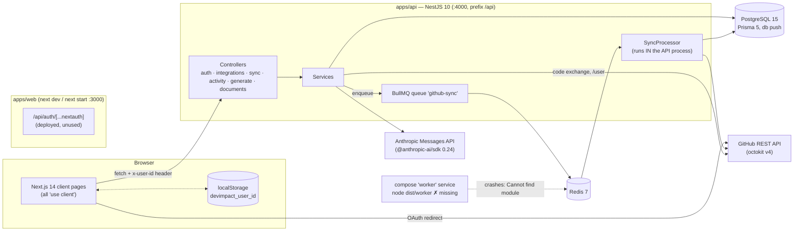
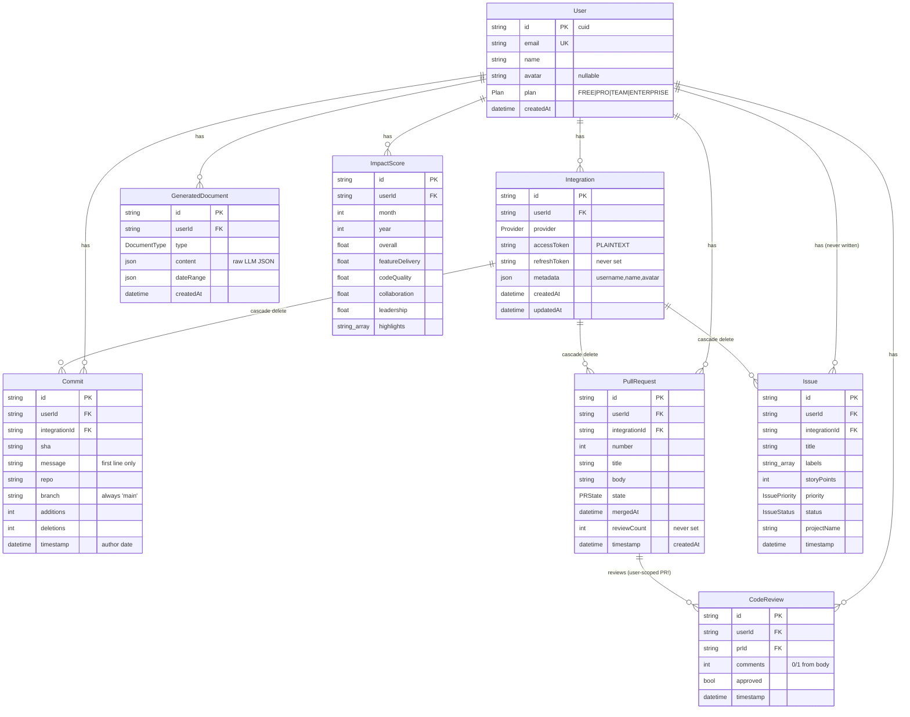
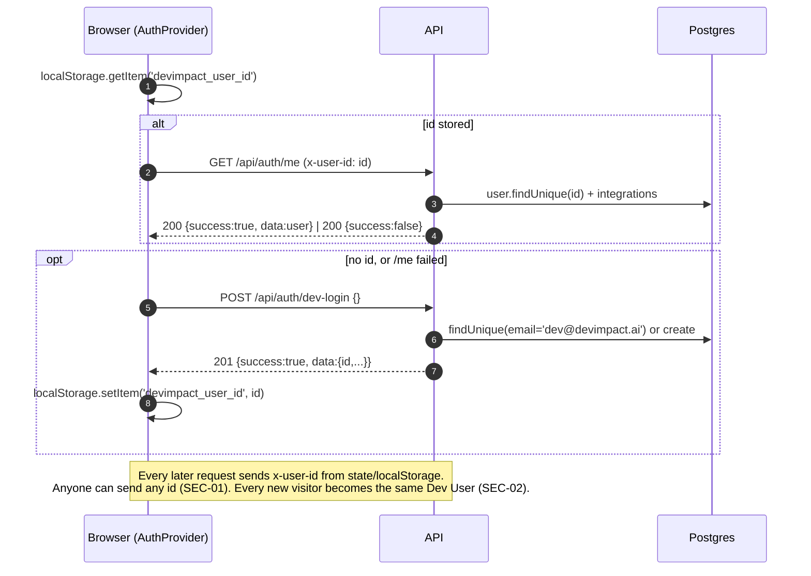
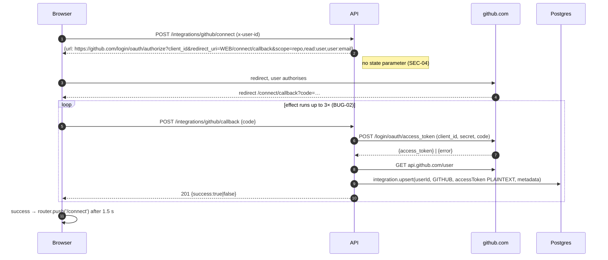
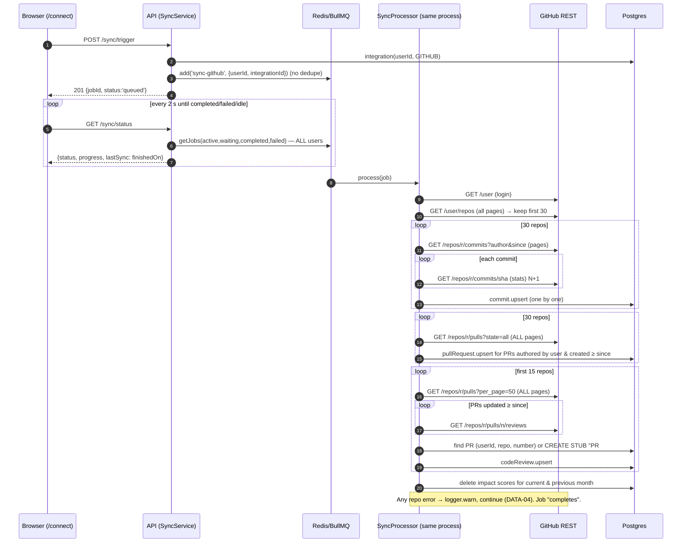
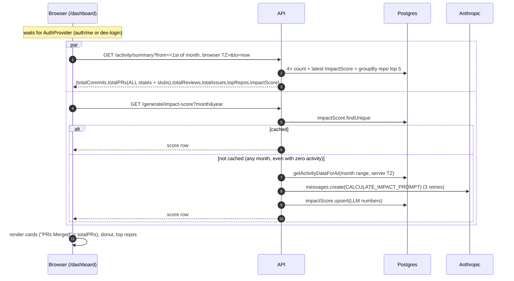
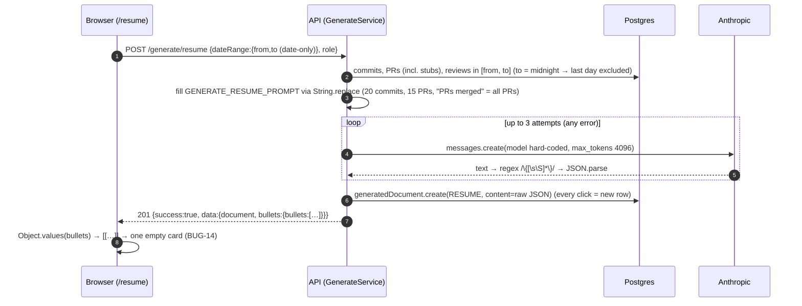

# Current Architecture — DevImpact AI v0.1.0

As found at baseline `ed6ed4f` (identical application code on `main@1cde043`). Every source file
listed in `git ls-files` outside `docs/` was read for this document (≈ 4.5k lines). Issue IDs refer
to [`ISSUES.md`](ISSUES.md).

## Contents
1. [System overview](#1-system-overview)
2. [API modules](#2-api-modules)
3. [Data model](#3-data-model)
4. [Runtime flows (sequence diagrams)](#4-runtime-flows)
5. [Sync engine deep dive](#5-sync-engine-deep-dive)
6. [AI layer deep dive](#6-ai-layer-deep-dive)
7. [Frontend route map](#7-frontend-route-map)
8. [Configuration & environment inventory](#8-configuration--environment-inventory)
9. [Build, tooling & dependencies](#9-build-tooling--dependencies)

---

## 1. System overview



Key facts:

- **Identity** is the `x-user-id` header, set by the browser from `localStorage` (SEC-01). The web
  app auto-calls `POST /auth/dev-login` when no ID is stored (SEC-02).
- **Background work** happens in the API process (`SyncProcessor` is a provider of `SyncModule`).
  The compose `worker` service points at a non-existent entry (OPS-03).
- **No server-side rendering of data**: every page is a client component that fetches from the API
  after `auth/me` resolves (PERF-04).
- **`packages/shared`** (enums, Zod schemas, types) is imported by neither app (DEBT-01).

## 2. API modules

Global setup (`apps/api/src/main.ts`): CORS origin = `NEXTAUTH_URL` (credentials on), global
`ValidationPipe({ whitelist, transform })` — inert because no DTO classes exist (API-02) — and
global prefix `/api`. No exception filter, helmet, throttler, logger, or health endpoint.
`app.module.ts` wires `ConfigModule.forRoot({ isGlobal: true })` (loads `.env` from the process cwd
— `apps/api` under `npm run dev:api`, so the root `.env` is **not** loaded, OPS-07) and
`BullModule.forRoot({ connection: { host: REDIS_HOST, port: REDIS_PORT } })`.

Every controller method repeats the same pattern: read `req.headers['x-user-id']`, return
`errorResponse('Not authenticated')` (HTTP 200/201) if absent, call the service, wrap in
`successResponse` / `errorResponse` from `common/api-response.ts` (API-01).

| Module | Controller routes | Service responsibilities | Depends on | Notes |
|---|---|---|---|---|
| `PrismaModule` (global) | — | `PrismaService extends PrismaClient`, connect/disconnect hooks | — | |
| `AuthModule` | `POST /auth/dev-login`, `POST /auth/github`, `POST /auth/google`, `GET /auth/me` | `findOrCreateUser(email,name)`, `getUserById` (+ integrations id/provider/createdAt) | Prisma | dev-login public (SEC-02); github/google are stubs (API-03) |
| `IntegrationsModule` | `GET /integrations`, `POST /integrations/github/connect`, `POST /integrations/github/callback`, `DELETE /integrations/:id` | Build OAuth URL (scope `repo,read:user,user:email`, no `state`); exchange code via `fetch` to github.com; fetch `/user`; upsert `Integration` (plaintext token); delete (cascade) | Prisma, Config | SEC-03/04/05, DATA-07, SEC-13 |
| `SyncModule` | `POST /sync/trigger`, `GET /sync/status` | Enqueue `sync-github` job `{userId, integrationId}`; status = latest of *all* jobs filtered in memory | BullMQ queue, Prisma, `GitHubModule` | `SyncProcessor` lives here (see §5); DATA-06 |
| `GitHubModule` | — | Octokit wrappers: `fetchUserRepos`, `fetchCommits` (+ per-commit `getCommit`), `fetchPullRequests`, `fetchReviews`, `getUsername`; new `Octokit` per call | octokit | errors swallowed per repo (DATA-04) |
| `ActivityModule` | `GET /activity/commits`, `/activity/prs`, `/activity/summary` | Paginated lists (`skip/take` unvalidated), counts + top-5 repos by commits + latest impact score; `getActivityDataForAI` (all rows in range, trimmed fields) | Prisma | SEC-06, BUG-04/05, DATA-02 |
| `GenerateModule` | `POST /generate/resume`, `/appraisal`, `/promotion`, `GET /generate/impact-score` | Resolve date range (server-local time), load activity, call `AIService`, persist `GeneratedDocument` / upsert `ImpactScore` | Prisma, `AIModule`, `ActivityModule` | BUG-06/07, AI-01, API-04 |
| `AIModule` | — | Prompt templating (`String.replace`), `messages.create` (non-streaming, `max_tokens 4096`), regex JSON extraction, 3 retries | Config, Anthropic SDK, `prompts/*.ts` | §6 |
| `DocumentsModule` | `GET /documents`, `GET /documents/:id`, `DELETE /documents/:id` | List (unbounded `limit`), get/delete scoped by `userId` | Prisma | SEC-06, BUG-12 |

Endpoint inventory: 20 routes (verified from the Nest route map in `logs/api-dev.log`).
`POST /integrations/github/callback` exists but is not listed in the root README.

## 3. Data model



Unique keys / indexes: `User.email`; `Integration(userId, provider)` (one GitHub account per
user); `Commit(userId, sha)`; `PullRequest(userId, repo, number)`; `CodeReview(userId, prId,
timestamp)`; `ImpactScore(userId, month, year)`; `@@index([userId, timestamp])` on activity
tables; `GeneratedDocument(userId, type)`.

Field-level notes (unused, misnamed, misused):

| Field / model | Problem | Issue |
|---|---|---|
| `Integration.accessToken` | Plaintext; `repo` scope | SEC-03, SEC-05 |
| `Integration.refreshToken` | Never written (GitHub OAuth Apps don't issue them) | DATA-10 |
| `Integration` | No `lastSyncedAt`/cursor, no GitHub user id, no sync state | DATA-10, GAP-01 |
| `Commit.branch` | Hard-coded `'main'` | DATA-05 |
| `Commit.message` | Only the subject line is stored | DATA-05 |
| `Commit` upsert | Update branch only refreshes additions/deletions | — |
| `PullRequest` | No author login → the model cannot represent "PR I reviewed" | DATA-01 |
| `PullRequest.reviewCount` | Never populated | DATA-08 |
| `PullRequest.timestamp` | PR creation time; no `updatedAt`/`closedAt` | DATA-10 |
| `CodeReview.prId` | Must point at a PR **owned by the reviewer** → stub PRs are inserted | DATA-01 |
| `CodeReview.comments` | `1` if the review had a body, else `0` | DATA-08 |
| `Issue` (whole model) + `IssueStatus/IssuePriority` enums | Never written or read except `count` in summary | DATA-10 |
| `GeneratedDocument.content` | Unvalidated LLM JSON; no version, title, edit history, prompt/model metadata | AI-03 |
| `DocumentType.KPI` | Never produced | GAP |
| `ImpactScore.*` | LLM-produced floats; `highlights` not in the original spec | AI-01 |
| Missing tables | Sync runs, sessions/accounts, AI usage, webhooks deliveries | DATA-06, AI-08 |

Schema is applied with `prisma db push`; migrations are git-ignored (DEBT-05).

## 4. Runtime flows

### 4.1 First visit / "login"



### 4.2 GitHub connect



No sync is triggered automatically on connect; the user must press **Sync**.

### 4.3 Sync job



### 4.4 Dashboard load



(In dev, StrictMode + `apiFetch` identity changes double every request — BUG-11.)

### 4.5 Resume generation



Appraisal and promotion follow the same pattern (appraisal: monthly/quarterly/yearly range in
server-local time; promotion: fixed "last 6 months"), and are rendered as raw JSON (UX-04).

### 4.6 Impact score

Covered in 4.4. Additional facts: the score is fully LLM-generated (AI-01); the GET has side
effects (API-04); `force=true` bypasses the cache; sync invalidates only the current and previous
month (DATA-09); the prompt asks the model to compute a weighted average itself.

## 5. Sync engine deep dive

Traced line by line (`sync.processor.ts`, `github.service.ts`) and **executed**: the real compiled
`SyncProcessor` + `GitHubService` were run against the local DB with GitHub replaced by an
in-process fake (`globalThis.fetch` stub — octokit v4 uses global fetch) using
[`scripts/sync-repro.cjs`](scripts/sync-repro.cjs). Outputs:
[`logs/sync-repro-correctness.txt`](logs/sync-repro-correctness.txt),
[`logs/sync-repro-scale.txt`](logs/sync-repro-scale.txt).

### 5.1 Correctness bugs (each with a concrete example)

| # | Bug | Concrete example (from the correctness run) | Issue |
|---|---|---|---|
| 1 | Reviewed-only PRs become the user's own PRs | Bob's **open** PR #2 and Carol's PR #3, which `alice-sync` only reviewed, are stored in Alice's `pull_requests` as `"PR #2"` / `"PR #3"`, `state: CLOSED`, timestamp = review time. Alice's PR count goes from 2 to 4 | DATA-01 |
| 2 | Rate-limited repo silently skipped | Every call to `acme/lib` returned a secondary-rate-limit 403. octokit's throttling plugin retried once (with `retry-after: 0` it falls back to **60 s**), then the error was swallowed by `GitHubService`. Commit `l1` was lost; the job result was `{totalCommits:3,totalPRs:2,totalReviews:3}` with no error; the run took **180 s** | DATA-04 |
| 3 | Review semantics lossy | A review with body "see 7 inline comments" stored as `comments: 1`; CHANGES_REQUESTED then APPROVED on PR #2 stored as two reviews | DATA-08 |
| 4 | Progress never completes | Last progress update 72 % (2 repos); 98 % in the scale run | BUG-09 |
| 5 | Branch coverage | `listCommits` without `sha` = default branch only; stored `branch` is always `main` | DATA-05 |
| 6 | Coverage limits | Only first 30 repos by `pushed` (scale run: repos 31–70 never synced); reviews only for the first 15 | DATA-03 |
| 7 | PR window | Authored PRs filtered by `created_at ≥ since` → a PR opened 7 months ago and merged last week is excluded | DATA-05 |
| 8 | Message truncation | Only the subject line of commit messages is kept (body discarded) | DATA-05 |

### 5.2 GitHub API call estimate

Per sync, with `R` synced repos (≤ 30), `C` user commits per repo in the window, `P` total PRs per
repo (all time), `Pw` PRs updated in the window, review repos `Rr = min(R, 15)`:

```
calls = 1 (GET /user) + ceil(repos/100)
      + Σ_R [ ceil(C/100) + C (getCommit, N+1) + ceil(P/100) (pulls, ALL pages) ]
      + Σ_Rr [ ceil(P/50) (pulls, ALL pages) + Pw (listReviews) ]
```

For **30 repos × 200 commits**, 600 PRs per repo, ~154 updated in the window:
`2 + 30 × (2 + 200 + 6) + 15 × (12 + 154) = 8,732` — exactly what the scale run measured:

| Endpoint | Calls |
|---|---|
| `GET /user`, `GET /user/repos` | 2 |
| `GET /repos/:r/commits` (list pages) | 60 |
| `GET /repos/:r/commits/:sha` (N+1 stats) | **6,000** |
| `GET /repos/:r/pulls` per_page=100 (authored PRs) | 180 |
| `GET /repos/:r/pulls` per_page=50 (reviews pass) | 180 |
| `GET /repos/:r/pulls/:n/reviews` | 2,310 |
| **Total** | **8,732** (> 5,000/h authenticated limit) |

Result in DB: 6,000 commits, 2,700 PRs of which **1,920 (71 %) are review stubs**, 1,920 reviews;
133 s wall time even with an instant fake GitHub (one DB round-trip per row, PERF-02). Against real
GitHub this sync would hit the primary rate limit part-way, wait for reset once per request, then
silently drop the rest (PERF-01 + DATA-04).

### 5.3 Other observations

- A new `Octokit` per method call → throttling/concurrency state is not shared across calls.
- `fetchReviews` uses `octokit.paginate` (collects **all** pages first) then `break`s on the first
  PR older than `since` — the break saves review calls, not page calls.
- The processor reads the token, then never handles `401 Bad credentials` specially (the whole job
  fails, as seen in API probe SYNC-5; no "reconnect" prompt).
- No `SyncRun` persistence: history lives only in BullMQ's completed/failed sets.

## 6. AI layer deep dive

`AIService` (one class, 217 lines) + five prompt files in `apps/api/src/prompts/`. All calls go
through `callClaude(prompt)`: single user message, no system prompt, `model:
'claude-sonnet-4-20250514'` (hard-coded), `max_tokens: 4096`, non-streaming, first content block
must be text, `/\{[\s\S]*\}/` greedy match, `JSON.parse`, cast to `T` without validation; on *any*
exception retry with 1 s, 2 s backoff (3 attempts).

| Prompt | Inputs (from `getActivityDataForAI`) | Sampling | Output parsing | Failure modes | Est. size / cost per call* |
|---|---|---|---|---|---|
| `generate-resume.ts` | role, date range, counts, top-10 repos, commits, PRs | 20 most recent commits (subject + repo), 15 most recent PRs (title + state) | `{bullets:[{text,category,impact}]}` unvalidated | "Pull Requests **Merged**" filled with *all* PRs incl. stubs (AI-07); `role` unbounded (SEC-07); `$`-patterns (AI-05); page shows empty card (BUG-14) | ~3.1k chars ≈ 0.8k input tokens + ≤ 4k output → ≈ $0.01–0.06 |
| `generate-appraisal.ts` | period, month, year, counts | 10 merged PRs, 15 commits (+/−) | `{executiveSummary, keyContributions[], metrics{}, ...}` unvalidated | Model invents `metrics` although real counts exist; invalid period silently "monthly" (BUG-07) | ~2.2k chars ≈ 0.6k tokens |
| `generate-promotion.ts` | current/target role, counts, avg PR size | 10 most recent PRs incl. stubs as "Notable Work" | `{whyReady, leadershipEvidence[], ...}` | `avgPRSize` = commit LOC ÷ PR count (meaningless); "undefined" roles when body empty | ~1.7k chars |
| `calculate-impact.ts` | month/year, counts, LOC totals | 10 most recent commits | `{overall, featureDelivery, codeQuality, collaboration, leadership, highlights[]}` | Called for months with **zero** activity; numbers unconstrained (could be > 100 or strings); model computes weighted average | ~1.1k chars; triggered by page views |
| `enhance-commit.ts` | one commit | — | `{enhanced, category}` | Not exposed (AI-09) | — |

\* Size measured from captured prompts in [`logs/ai-prompts/`](logs/ai-prompts/) for the seeded
user (~4 chars/token). Cost depends on the model chosen in P08; at Sonnet-class pricing a
generation is cents, but with no quotas a single client can loop it (SEC-07) — e.g. the 100 KB
`role` probe produced a 203,078-character prompt (≈ 50k input tokens), and every failure is
retried and re-billed up to 3× (AI-04).

**`String.replace` `$`-pattern bug** — [`scripts/replace-dollar-repro.mjs`](scripts/replace-dollar-repro.mjs):

```js
const TEMPLATE = 'Current Role: {{currentRole}}\nTarget Role: {{targetRole}}';
TEMPLATE.replace('{{currentRole}}', 'Senior $& Engineer')
// => 'Current Role: Senior {{currentRole}} Engineer\n...'   ($& = the matched text)
TEMPLATE.replace('{{currentRole}}', "Senior $' Engineer").replace('{{targetRole}}', 'Staff')
// => 'Current Role: Senior \nTarget Role: Staff Engineer\nTarget Role: {{targetRole}}'
// Fix: TEMPLATE.replace('{{currentRole}}', () => value)
```

Observed end-to-end in captured prompts: `Role: backend {{role}} lead`
(`ai-prompts/008-resume.json`) and the whole prompt prefix spliced into `Current Role`
(`ai-prompts/009-promotion.json`).

## 7. Frontend route map

Shell: `app/layout.tsx` = `<AuthProvider>` + `<Sidebar>` (hidden below `lg`) + scrolling `<main>`
inside `h-screen`. No `loading.tsx`, `error.tsx`, `not-found.tsx`, middleware or route protection.
Font: Inter (Google). Theme: shadcn CSS variables (light + unused `.dark`).

| Route | File | Data fetched | Components used | States handled | Notes |
|---|---|---|---|---|---|
| `/` | `app/page.tsx` | — | — | — | Server `redirect('/dashboard')` |
| `/dashboard` | `app/dashboard/page.tsx` | `GET /activity/summary` (month), `GET /generate/impact-score` (month) | Card, Button, `ImpactScoreCard` | full-page spinner; empty-state card; **no error state** | "PRs Merged" mislabeled; no chart/feed |
| `/connect` | `app/connect/page.tsx` | `GET /integrations`, `GET /sync/status`, `POST /integrations/github/connect`, `DELETE /integrations/:id`, `POST /sync/trigger` + 2 s polling | Card, Button, `SyncStatusBadge` | spinner; connecting/syncing/disconnecting flags; `alert()` on connect error | Badge "complete" whenever connected (BUG-08); interval leak (BUG-10) |
| `/connect/callback` | `app/connect/callback/page.tsx` | `POST /integrations/github/callback` | Card, lucide icons | processing / success / error | `useSearchParams` without Suspense → build fails (BUG-01); posts code ×3 (BUG-02) |
| `/resume` | `app/resume/page.tsx` | `POST /generate/resume` | Card, Button, `GenerateButton`, `ResumeBulletCard` | loading button, inline error text | Native date inputs; Copy/Export dead; BUG-14 |
| `/appraisal` | `app/appraisal/page.tsx` | `POST /generate/appraisal` | Card, Button, `GenerateButton`, `DocumentPreview` | loading, inline error | Raw JSON preview; Export dead |
| `/promotion` | `app/promotion/page.tsx` | `POST /generate/promotion` | Card, `GenerateButton`, `DocumentPreview` | loading, inline error | Raw JSON preview |
| `/career` | `app/career/page.tsx` | `GET /activity/commits` + `/activity/prs` (6 months, `limit=200`) | Card, Badge, Button | spinner, empty state | Client-side quarter grouping, 8 items/quarter |
| `/kpis` | `app/kpis/page.tsx` | `GET /activity/summary`, `GET /generate/impact-score` | Card, `ImpactScoreCard` | spinner | Mislabeled cards (UX-06); no trends |
| `/settings` | `app/settings/page.tsx` | none (user from context) | Card, Button, Badge, Separator | — | All controls inert; uses `defaultValue` (stale if user loads late) |
| `/api/auth/[...nextauth]` | route handler | GitHub/Google providers | — | — | Deployed but unused; sign-in page `/auth/signin` doesn't exist (SEC-15) |

Components: `ImpactScoreCard` (SVG donut + 4 bars), `SyncStatusBadge`, `GenerateButton`,
`ResumeBulletCard`, `DocumentPreview` (JSON `<pre>`), `Sidebar`, **`ActivityHeatmap` (unused)**,
`ui/{badge,button,card,progress (unused),separator}`. Missing spec component: `DateRangePicker`.

Data layer: `lib/auth-context.tsx` exposes `apiFetch` (adds `x-user-id`, swallows network errors
as `{success:false,error:'Network error'}`, never checks HTTP status); `lib/utils.ts` has a second,
unused `apiFetch` (DEBT-06). All pages use `useEffect` + `useState`.

## 8. Configuration & environment inventory

| Variable | Read in code | Declared in `.env.example` | In `docker-compose.yml` | Notes |
|---|---|---|---|---|
| `DATABASE_URL` | Prisma schema (`env("DATABASE_URL")`) | ✅ | ✅ (overrides to `postgres` host) | Prisma CLI in `apps/api` doesn't see root `.env` (OPS-07) |
| `REDIS_URL` | ❌ never | ✅ | ❌ | Unused; shared `envSchema` requires it (OPS-10) |
| `REDIS_HOST` | `app.module.ts:19` | ✅ | ✅ | |
| `REDIS_PORT` | `app.module.ts:20` | ✅ | ✅ | |
| `PORT` | `main.ts:23` | ✅ | ✅ (api) | Also picked up by `next dev` when exported (OPS-08) |
| `ANTHROPIC_API_KEY` | `ai.service.ts:31` (ConfigService) | ✅ | via `env_file` | Not loaded from root `.env` in dev (OPS-07) |
| `ANTHROPIC_BASE_URL` | implicitly by the SDK | ❌ | ❌ | Used by this audit to mock the API (OPS-15) |
| `GITHUB_CLIENT_ID` | `integrations.service.ts:47,54`; NextAuth route | ✅ | via `env_file` | |
| `GITHUB_CLIENT_SECRET` | `integrations.service.ts:55`; NextAuth route | ✅ | via `env_file` | |
| `GOOGLE_CLIENT_ID` / `_SECRET` | NextAuth route only (unused) | ✅ | via `env_file` | |
| `NEXTAUTH_SECRET` | NextAuth (implicit) | ✅ | via `env_file` | NextAuth unused |
| `NEXTAUTH_URL` | `main.ts:9` (CORS origin), `integrations.service.ts:48` (OAuth redirect base) | ✅ | via `env_file` | Overloaded meaning (OPS-10) |
| `NEXT_PUBLIC_API_URL` | `apps/web/src/lib/utils.ts:8` (build-time inlined) | ✅ | build arg | Next only reads `.env` in `apps/web` — root value ignored unless exported |
| `NODE_ENV` | Next/Nest internals only | ❌ | ❌ | No environment-specific behaviour (dev-login always on) |

No env validation at startup anywhere; `packages/shared/src/schemas.ts:35-46` defines an
`envSchema` that nothing calls (and that would reject a valid local setup without Google creds).

## 9. Build, tooling & dependencies

Commands run at the repo root on the baseline (Node 22.23.4, npm 10.9.9); full output in `logs/`.

| Command | Result | Log |
|---|---|---|
| `npm ci` | ✅ 894 packages; npm reports 47 vulnerabilities (all deps) | `logs/npm-ci.txt` |
| `npm run typecheck` | ✅ api, web, shared pass | `logs/root-typecheck.txt` |
| `npm run build` | ❌ api ✅ (`nest build`), **web ❌** (`useSearchParams()` Suspense error on `/connect/callback`), shared ✅ (built *last*) | `logs/root-build.txt` |
| `npm run lint` | ❌ api: "ESLint couldn't find a configuration file"; web: interactive `next lint` setup prompt | `logs/root-lint.txt` |
| `npm test` | ❌ no `test` script, no tests | — |
| `npm run dev:api` (after a build) | ❌ `Cannot find module '/home/user/ai_/apps/api/dist/main'` (stale tsbuildinfo, BUG-03); ✅ after deleting `apps/api/tsconfig.tsbuildinfo` | `logs/api-dev-first-attempt-FAILED.log`, `logs/api-dev.log` |
| `npm run dev:web` | ✅ (❌ `EADDRINUSE :4000` if root `.env` is exported, OPS-08) | `logs/web-dev.log`, `logs/web-dev-with-exported-env-FAILED.log` |
| `docker compose up -d postgres redis` | ✅ (after starting `dockerd` in the container) | — |
| `docker compose build` | ❌ `invalid tag "ai_-web"` (project name from dir `ai_`, OPS-09); with `-p devimpact`: Docker Hub `429` (OPS-14), then inside-build `npm install` can't reach the registry in this sandbox | `logs/docker-compose-build*.log` |
| API image (sandbox CA/proxy injected via a throw-away copy of the Dockerfile) | ❌ `TS5083 Cannot read file '/app/tsconfig.base.json'` (OPS-01) → after copying it: ❌ `"/app/apps/api/node_modules/.prisma": not found` (OPS-04) → after dropping that line: builds, but **crashes at boot** with `ERR_REQUIRE_ESM` (octokit, Node 18, OPS-02); `node dist/worker` → `Cannot find module '/app/dist/worker'` (OPS-03) | `logs/docker-build-api*.log`, `logs/docker-runtime-api*.txt` |
| Web image (same method) | ❌ OPS-01, then ❌ BUG-01; would then fail on `COPY apps/web/public` (OPS-05) | `logs/docker-build-web*.log` |

### Dependency audit

`npm outdated` ([`logs/npm-outdated.txt`](logs/npm-outdated.txt)) — majors behind:

| Area | Package | Current | Latest | Majors behind |
|---|---|---|---|---|
| Web | `next` / `eslint-config-next` | 14.2.3 | 16.4.5 | 2 |
| Web | `react`, `react-dom`, `@types/react*` | 18.3.1 | 19.3.x | 1 |
| Web | `tailwindcss` | 3.4.19 | 4.3.5 | 1 |
| Web | `recharts` (unused) | 2.15.4 | 3.10.1 | 1 |
| Web | `lucide-react` | 0.378.0 | 1.70.0 | 1 |
| Web | `date-fns` (unused), `tailwind-merge` | 3.6 / 2.6 | 4.4 / 3.7 | 1 |
| API | `@nestjs/*` (common, core, platform-express, cli, schematics, bullmq) | 10.x | 12.x | 2 |
| API | `@nestjs/config` | 3.3.0 | 12.1.1 | (re-versioned) |
| API | `@prisma/client`, `prisma` | 5.22.0 | 7.10.1 | 2 |
| API | `@anthropic-ai/sdk` | 0.24.3 | 1.6.0 | 1 (and 0.x → 1.x API changes) |
| API | `bullmq` | 5.77 | 6.7 | 1 |
| API | `octokit` | 4.1.4 | 5.0.5 | 1 |
| API | `ioredis` | 5.11 | 6.0 | 1 |
| Shared | `zod` | 3.25.76 | 4.6.7 | 1 |
| Tooling | `eslint` | 8.57.1 (EOL) | 10.14.0 | 2 |
| Tooling | `typescript` | 5.9.3 | 7.0.2 | 2 |
| Tooling | `@typescript-eslint/*` | 7.18 | 8.72 | 1 |

`npm audit --omit=dev` ([`logs/npm-audit-prod.txt`](logs/npm-audit-prod.txt)): **22 vulnerable
packages — 3 critical, 11 high, 8 moderate**.

| Severity | Package (direct?) | Advisories (selection) | Fix |
|---|---|---|---|
| critical | `next` (direct) | GHSA-f82v-jwr5-mffw (CVE-2025-29927, middleware auth bypass — no middleware in this app), GHSA-2xp9-vwfh-vxw4 & GHSA-2464-fhr4-w9xw (image optimizer RCE), GHSA-p293-qw3h-jr36 (RCE on Windows hosts), many DoS/cache-poisoning/SSRF (37 total) | 14.2.35 (patch) → 16.x |
| critical | `next-auth` (direct) | GHSA-x445-f3h2-j279 (OAuth state/PKCE cookies not bound to provider), GHSA-7rqj-j65f-68wh, GHSA-xmf8-cvqr-rfgj | 4.24.15+ or replace (D-003) |
| critical | `proxy-addr` (via express) | GHSA-jqcg-44mw-7w3h (IP spoofing) | Nest/Express upgrade |
| high | `@nestjs/platform-express`, `body-parser`, `multer` | body-parser DoS (GHSA-v422-hmwv-36x6, GHSA-27r3-jxmh-p828); multer DoS ×4 | `@nestjs/platform-express` ≥ 11.1.15 |
| high | `@nestjs/config`, `lodash` | lodash code injection / prototype pollution (GHSA-r5fr-rjxr-66jc, GHSA-xxjr-mmjv-4gpg) | `@nestjs/config` upgrade |
| high | `zod` (direct) | GHSA-mrhx-c7xc-m3w5 (memory exhaustion) | zod 4.6.6+ |
| high | `postcss`, `picomatch`, `nanoid`, `source-map-js`, `form-data` | XSS/path traversal in postcss; ReDoS; CRLF injection | transitive upgrades |
| moderate | `@nestjs/core`, `@nestjs/common`, `@nestjs/bullmq`, `qs`, `uuid`, `file-type`, `postcss-selector-parser` | GHSA-36xv-jgw5-4q75 (Nest injection) etc. | Nest upgrade |

Unused dependencies (imports grep): web `recharts`, `date-fns`, `@radix-ui/react-{avatar,dialog,
dropdown-menu,label,popover,select,tabs,tooltip}`; api `passport`, `passport-github2`,
`class-validator`, `class-transformer`, `zod`, direct `ioredis`; `@devimpact/shared` in both apps
(DEBT-07, DEBT-01).
