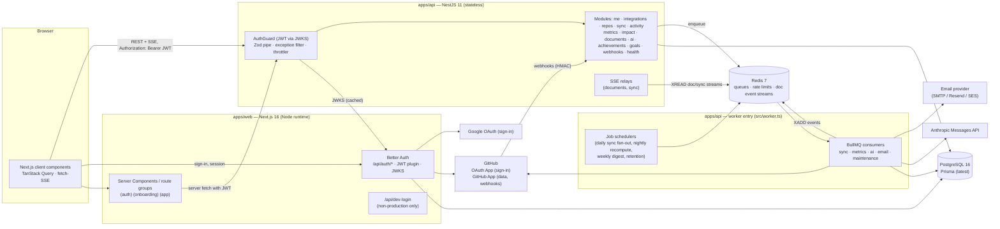
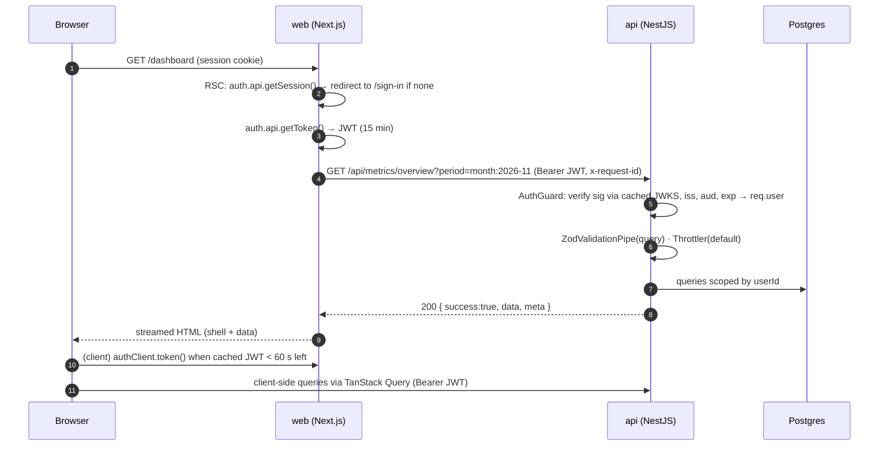
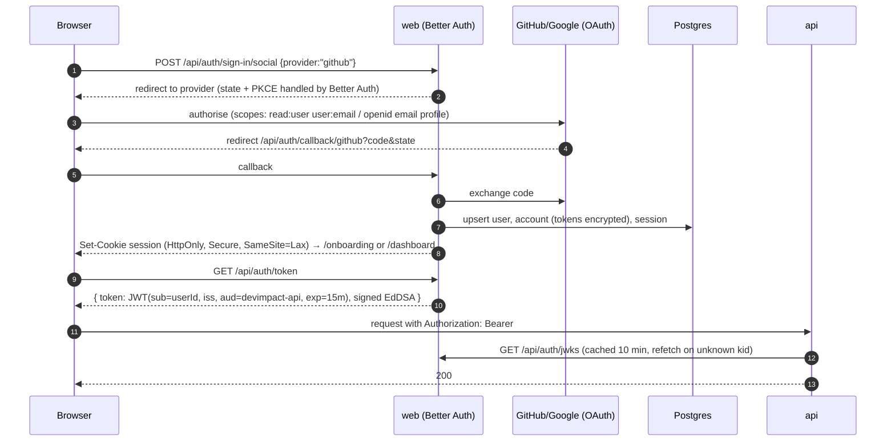
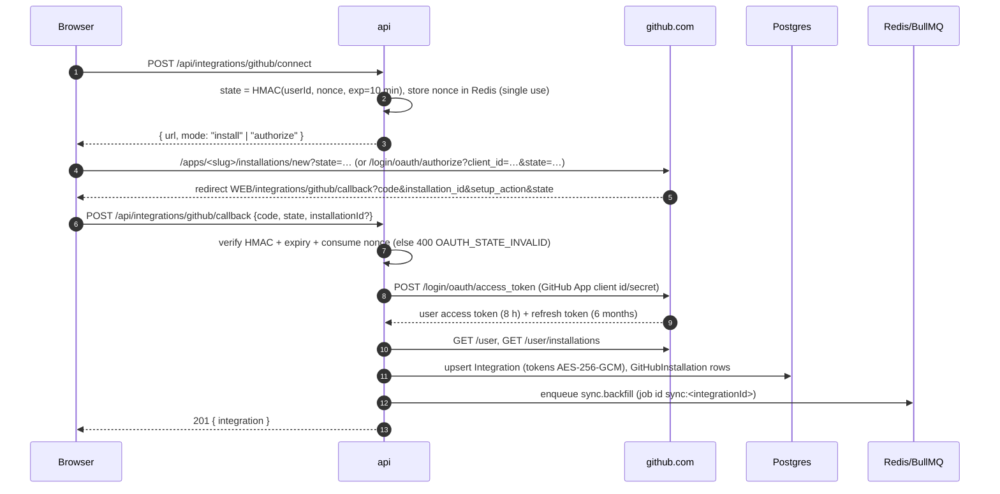
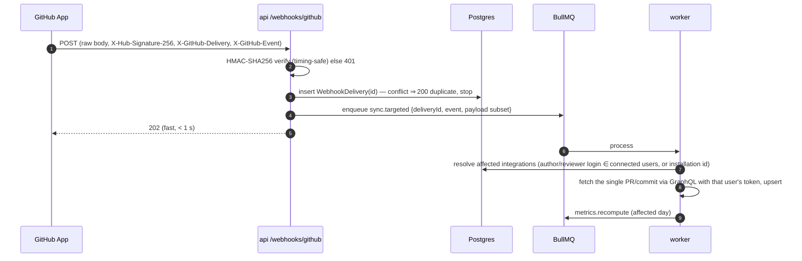
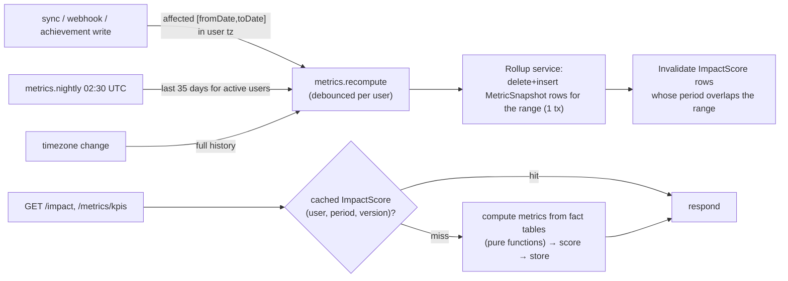
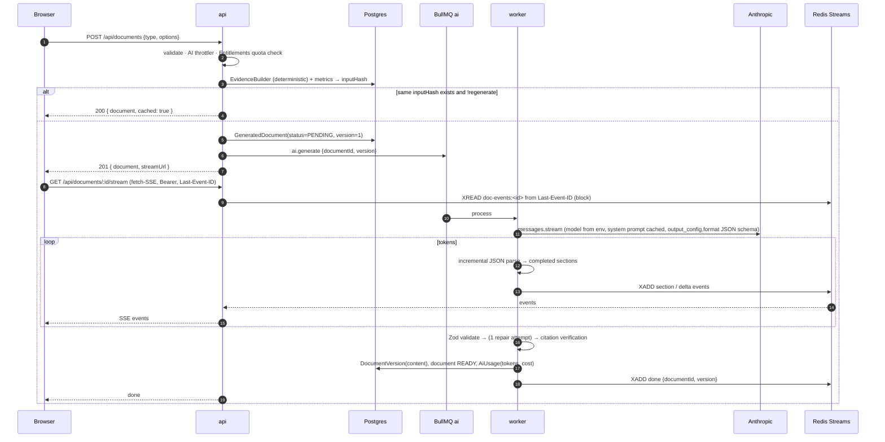

# Target Architecture — DevImpact AI v2.0

*Phase 03 · 2026-11-09 · Status: **binding**. Decisions referenced as ADR-00NN live in
[`adr/`](adr/README.md). Current-state comparison: [`../audit/ARCHITECTURE_CURRENT.md`](../audit/ARCHITECTURE_CURRENT.md).*

## Contents
1. [Component diagram](#1-component-diagram)
2. [Process model](#2-process-model)
3. [Request flow](#3-request-flow)
4. [Authentication flow](#4-authentication-flow)
5. [GitHub connection flow](#5-github-connection-flow)
6. [Sync flows](#6-sync-flows)
7. [Metrics rollup flow](#7-metrics-rollup-flow)
8. [AI generation flow](#8-ai-generation-flow)
9. [Caching layers](#9-caching-layers)
10. [Secrets & configuration](#10-secrets--configuration)
11. [Observability](#11-observability)
12. [Multi-tenancy & data ownership](#12-multi-tenancy--data-ownership)
13. [Code layout](#13-code-layout)

---

## 1. Component diagram



Key properties:
- **Two GitHub registrations** (ADR-0004): an *OAuth App* for sign-in (identity scopes only) and
  a *GitHub App* for data (read-only permissions, per-repo install, webhooks).
- **API never holds a session**: it verifies short-lived JWTs issued by Better Auth (ADR-0003),
  so it needs no cookies and no CSRF defence.
- **All slow or paid work runs in the worker** (sync, metrics recompute, AI generation, email).
  The API validates, enqueues and relays progress.

## 2. Process model

| Process | Entry | Scales | Responsibilities | Health |
|---|---|---|---|---|
| `web` | `next start` (standalone) | horizontally, stateless | Pages (RSC), Better Auth endpoints, JWKS, dev-login (non-prod) | `GET /api/health` (web) |
| `api` | `node dist/main.js` | horizontally, stateless | REST + SSE, validation, auth guard, rate limits, enqueue, webhooks ingress | `GET /api/health`, `GET /api/health/ready` (DB + Redis) |
| `worker` | `node dist/worker.js` | horizontally (BullMQ concurrency per queue) | Queue consumers; registers job schedulers idempotently on boot | liveness file/heartbeat key + `/healthz` on a small HTTP port |
| `postgres` | managed or compose | vertical | System of record | — |
| `redis` | managed or compose | vertical | BullMQ, throttler storage, Redis Streams for SSE, small caches | — |
| `migrate` | `prisma migrate deploy` (release step) | one-off | Schema migrations before rollout | — |

**Queues** (BullMQ, prefix `devimpact`):

| Queue | Jobs | Concurrency (default) | Job id / dedupe |
|---|---|---|---|
| `sync` | `sync.backfill`, `sync.incremental`, `sync.targeted` (webhook), `sync.fanout` (scheduler) | 5 | `sync:<integrationId>` for backfill/incremental (one run per integration); targeted: `sync-t:<deliveryId>` |
| `metrics` | `metrics.recompute {userId, fromDate, toDate}`, `metrics.nightly` | 5 | `metrics:<userId>` with 30 s debounce (range merged) |
| `ai` | `ai.generate {documentId, version}`, `ai.quick` | 4 | `ai:<documentId>:<version>` |
| `email` | `email.digest {userId, weekStart}`, `email.send` | 5 | `digest:<userId>:<weekStart>` |
| `maintenance` | retention purges, stale-run reaper, JWKS/key rotation reminders | 1 | fixed ids |

Schedulers (BullMQ `upsertJobScheduler`, registered by the worker on boot, idempotent):
`sync.fanout` hourly (enqueues `sync.incremental` for integrations whose jittered daily slot falls
in the hour → each active integration syncs once per 24 h), `metrics.nightly` 02:30 UTC,
`email.digest-fanout` hourly (users whose local Monday 09:00 falls in the hour), `maintenance.*` daily.

## 3. Request flow



- `x-request-id` is generated at the edge of `web` (or by `api` if absent), logged by both, and
  copied into job payloads so worker logs correlate.
- Errors use the D-006 envelope with correct HTTP codes (ADR-0006); `401` makes the web client
  refresh the JWT once, then redirect to sign-in.

## 4. Authentication flow



- **Account linking:** same verified email across GitHub and Google links to one user (Better
  Auth `accountLinking`, trusted providers `github`, `google`). Legacy v0.1 users are linked on
  first sign-in by email (DATA_MODEL_V2 §5).
- **Sign-out** deletes the session; outstanding JWTs expire within 15 minutes (accepted risk,
  documented; sensitive actions — account deletion, data purge — additionally require a fresh
  session check via `POST /api/auth/...` freshness on the web side before calling the API).
- **Dev login** (`POST /api/dev-login` on web) exists only when
  `NODE_ENV !== 'production' && ENABLE_DEV_LOGIN === 'true'`; the route module throws at import
  in production builds and returns 404. It signs in a seeded user (email/password provider enabled
  only under the same condition).

## 5. GitHub connection flow



- The same GitHub account cannot be linked to two DevImpact users (`409 INTEGRATION_ACCOUNT_IN_USE`).
- Users without an installation get `mode: "install"`; users who already installed but whose token
  is missing/expired get `mode: "authorize"`.
- **Disconnect**: revoke the user token (`DELETE /applications/{client_id}/token`), delete tokens,
  set `status = DISCONNECTED`; with `purgeData=true` delete the integration's activity rows.
  Uninstalling the app is a GitHub-side action we link to (we cannot uninstall org installations
  on the user's behalf).

## 6. Sync flows

Full rationale and API budget: [ADR-0007](adr/ADR-0007-sync-strategy.md).

### 6.1 Stages (all job types)
1. **Prepare** — load integration, refresh the user token if it expires in < 10 min; on refresh
   failure or 401 → `NEEDS_REAUTH`, pause schedule, `SyncRun.status = FAILED (errorCode GITHUB_REAUTH_REQUIRED)`.
2. **Repositories** — list installations and their repos (`GET /user/installations`,
   `/user/installations/{id}/repositories`), plus repos discovered by stage 3/5 results (public
   repos outside installations). Upsert `Repository`; new repos default `included = true` if they
   have user activity in the window, else `false`.
3. **Authored PRs** — GraphQL `search(type: ISSUE, query: "is:pr author:<login> updated:<from>..<to>")`,
   50 per page with nested fields (size, timestamps, first ready-for-review event, reviews summary,
   revert cross-references). If `issueCount > 1000`, split the window in halves recursively.
4. **Reviewed PRs** — GraphQL search `is:pr reviewed-by:<login> -author:<login> updated:<from>..<to>`
   with the user's reviews (`reviews(author: <login>)`, state, submittedAt, comment counts) and
   review-request events.
5. **Commits** — `user.contributionsCollection(from, to)` (≤ 1-year spans) →
   `commitContributionsByRepository` gives repos with commits; for each included repo,
   `defaultBranchRef.target.history(author: {id}, since, until)` 100 per page with
   `additions`, `deletions`, `changedFilesIfAvailable`, `parents.totalCount`,
   `associatedPullRequests(first:1)`.
6. **Persist** — batched writes per page in a transaction (`createMany skipDuplicates` +
   `updateMany` for changed rows), keyed by natural keys (DATA_MODEL_V2).
7. **Finalize** — advance cursors only after their stage committed; `SyncRun` = `SUCCEEDED` or
   `PARTIAL` (with per-stage errors); enqueue `metrics.recompute` for the affected date range.

Progress = completed work units / planned work units (units planned after stage 2 from search
`issueCount`s and contribution totals), updated per page; reaches exactly 100 on success.

### 6.2 Initial backfill
- Window: plan history window (FREE 12 months). Executed **newest first**: the last 30 days for all
  stages, then `metrics.recompute` (dashboard can render), then the remainder month by month.
- Trigger: on connect; on reconnect after `NEEDS_REAUTH` if the gap exceeds the incremental window.

### 6.3 Incremental (scheduled + manual)
- Cursor per stream (`Integration.syncCursor`): `authoredPrsUpdatedAt`, `reviewedPrsUpdatedAt`;
  per repo `Repository.commitCursor`. Query from `cursor − 1 h` (overlap absorbs clock skew;
  idempotent upserts make overlap free).
- Manual "Sync now" uses the same job (`trigger = MANUAL`), rate-limited to 6/hour per integration.

### 6.4 Webhooks (near-real-time)



Events handled: `pull_request` (opened, edited, closed, reopened, ready_for_review,
converted_to_draft), `pull_request_review` (submitted, edited, dismissed), `push` (default branch
only), `installation` / `installation_repositories` (repo access changes → repo list refresh),
`github_app_authorization` (revoked → `NEEDS_REAUTH`). Others → `IGNORED`.

### 6.5 Rate limits and failure handling
- Single Octokit instance per job with `@octokit/plugin-throttling` and `@octokit/plugin-retry`
  (retry on 5xx/abuse with backoff; throttling `onRateLimit` returns `false` → handled by us).
- Before each request batch, check remaining budget (REST headers / GraphQL `rateLimit { remaining
  resetAt cost }`). If `remaining < 200`, persist cursors, set `SyncRun.status = WAITING_RATE_LIMIT`,
  `resumeAt = resetAt + jitter`, and re-enqueue the job delayed until `resumeAt`. **Never** skip data.
- Per-repository errors (e.g. 404 after access removal) are recorded in `SyncRun.errors[]`; the run
  ends `PARTIAL` and the repo is marked `accessible = false`.

## 7. Metrics rollup flow



- Metric computation lives in pure functions (`metric-definitions.ts`) fed by a repository layer;
  no Prisma calls inside formulas (ADR-0008).
- GET endpoints never call the AI and never enqueue work; a cache miss is computed synchronously
  (bounded: indexed range scans over one user's rows).

## 8. AI generation flow

Details: [ADR-0009](adr/ADR-0009-ai-generation.md).



- Navigating away never loses work: the job continues; reopening the document replays events from
  the Redis stream (retained 1 h, `MAXLEN ~ 2000`) or loads the saved version.
- Cancel: `POST /documents/:id/cancel` sets a Redis flag the worker checks between chunks and aborts
  the Anthropic stream (`AbortController`); status `CANCELLED`; no quota consumed.
- Quick AI actions (achievement statement, impact highlights, digest summary) use the fast model,
  run in the worker via `ai.quick`, and the API waits (≤ 20 s) for the job result
  (`job.waitUntilFinished`) and returns JSON — no SSE.

## 9. Caching layers

| Layer | What | Invalidation |
|---|---|---|
| Browser (TanStack Query) | GET responses by query key; `staleTime` 30 s for metrics, 5 s for sync status while syncing | mutation-driven `invalidateQueries`; SSE `done` events |
| Next.js | No caching of user data (`cache: 'no-store'` for authenticated fetches); static assets via CDN | deploy |
| API in-memory | JWKS (10 min, refetch on unknown `kid`), metric definitions | TTL |
| Redis | Throttler counters, OAuth state nonces (10 min), doc event streams (1 h), sync progress pub | TTL |
| Postgres — `ImpactScore` | Computed period metrics + score per `(user, periodType, start, end, scoreVersion)` | `metrics.recompute` deletes overlapping rows |
| Postgres — `GeneratedDocument.inputHash` | AI result reuse | new evidence/metrics change the hash; explicit regenerate |
| Anthropic prompt cache | Stable system prompt + output schema prefix (`cache_control`) | prompt version change |
| GitHub | Incremental cursors (not HTTP caching) | per sync |

## 10. Secrets & configuration

- Each app validates its environment with a **Zod schema at startup** and exits non-zero on
  failure (`apps/api/src/config/env.ts`, `apps/web/src/env.ts`); schemas live next to the app,
  shared fragments in `packages/shared/src/env/`.
- Secrets never logged: pino `redact` paths for `authorization`, `cookie`, `*.token`, `*.accessToken*`,
  `*.refreshToken*`, `ANTHROPIC_API_KEY`, `GITHUB_*SECRET*`, `GITHUB_APP_PRIVATE_KEY`, `*_ENC`.
- Token encryption keys are versioned (ADR-0005). GitHub App private key is a PEM in an env var
  (base64) or mounted file (`GITHUB_APP_PRIVATE_KEY_FILE`).
- Environment variable inventory (final names; `.env.example` updated by the implementing phase):

| Variable | App | Phase | Notes |
|---|---|---|---|
| `DATABASE_URL` | web, api, worker | P02 | Better Auth and API share the DB |
| `REDIS_URL` | api, worker | P02 | replaces `REDIS_HOST/PORT` (OPS-10) |
| `API_PORT` / `WEB_PORT` | api / web | P02 | OPS-08 |
| `WEB_ORIGIN`, `API_ORIGIN` | web, api | P05 | CORS allow-list = `WEB_ORIGIN` (comma-separated) |
| `BETTER_AUTH_SECRET`, `BETTER_AUTH_URL` | web | P05 | replace `NEXTAUTH_*` |
| `AUTH_JWT_ISSUER`, `AUTH_JWT_AUDIENCE`, `AUTH_JWKS_URL` | web (iss/aud), api (verify) | P05 | defaults: `WEB_ORIGIN`, `devimpact-api`, `${WEB_ORIGIN}/api/auth/jwks` |
| `GITHUB_SIGNIN_CLIENT_ID`, `GITHUB_SIGNIN_CLIENT_SECRET` | web | P05 | OAuth App, identity scopes |
| `GOOGLE_CLIENT_ID`, `GOOGLE_CLIENT_SECRET` | web | P05 | |
| `ENABLE_DEV_LOGIN` | web | P05 | ignored when `NODE_ENV=production` |
| `GITHUB_APP_ID`, `GITHUB_APP_SLUG`, `GITHUB_APP_CLIENT_ID`, `GITHUB_APP_CLIENT_SECRET`, `GITHUB_APP_PRIVATE_KEY`, `GITHUB_WEBHOOK_SECRET` | api, worker | P05/P06 | |
| `GITHUB_API_URL` | api, worker | P06 | default `https://api.github.com`; tests point at fixtures |
| `TOKEN_ENCRYPTION_KEYS`, `TOKEN_ENCRYPTION_ACTIVE_KEY` | api, worker | P05 | ADR-0005 |
| `OAUTH_STATE_SECRET` | api | P05 | HMAC for connect `state` |
| `ANTHROPIC_API_KEY`, `ANTHROPIC_BASE_URL` | worker (api for none) | P08 | base URL for test mode (OPS-15) |
| `ANTHROPIC_MODEL_DEFAULT`, `ANTHROPIC_MODEL_FAST` | worker | P08 | defaults `claude-opus-5-5`, `claude-haiku-5-5` |
| `AI_FALLBACKS_ENABLED` | worker | P08 | server-side refusal fallback (ADR-0009) |
| `ENTITLEMENTS_JSON` | api, worker | P08/P12 | optional override of plan limits |
| `EMAIL_TRANSPORT`, `EMAIL_FROM`, `SMTP_URL` / `RESEND_API_KEY` | worker | P12 | `console` in dev |
| `UNSUBSCRIBE_TOKEN_SECRET` | api, worker | P12 | HMAC |
| `SENTRY_DSN_*`, `OTEL_EXPORTER_OTLP_ENDPOINT`, `LOG_LEVEL` | all | P14 | env-gated |
| `NEXT_PUBLIC_API_URL` | web | P02 | browser → API base URL |

## 11. Observability

- **Logs:** pino JSON (`nestjs-pino` in api/worker, pino in web route handlers) with `requestId`,
  `userId` (hashed in non-debug levels is not required; user IDs are cuids, not PII), `jobId`,
  `syncRunId`, latency. Redaction per §10.
- **Errors:** Sentry (or compatible) for web, api, worker; release-tagged; PII scrubbing (P14).
- **Traces:** OpenTelemetry auto-instrumentation (HTTP, Prisma, ioredis, fetch) with W3C
  `traceparent` propagated web → api → job data → worker → GitHub/Anthropic calls (P14).
- **Metrics / dashboards (P14):** HTTP rate/latency/errors by route; queue depth, job duration and
  failures per queue; sync duration, API calls per run, GitHub rate-limit headroom; AI tokens, cost
  and latency per prompt/model; quota rejections. Alerts documented in runbooks.
- **Operational UI:** Bull Board at `/api/admin/queues` behind an admin allow-list (P14).
- **Product analytics:** first-party events for PRD success metrics (P14 chooses tooling).

## 12. Multi-tenancy & data ownership

- v2.0 is single-user tenancy: **every row belongs to exactly one `userId`**, including copies of
  PRs relevant to several users (each user gets their own `PullRequest` row). This keeps
  authorization trivial (`WHERE userId = :me` everywhere) and makes deletion/export complete.
- All service/repository methods take `userId` as a required first argument; P05 adds a lint rule /
  test helper that fails if a Prisma query on a user-owned model lacks a `userId` filter
  (integration tests prove cross-user access returns 404).
- Third-party data minimisation: for reviewed PRs we store title, number, URL, author login and
  timestamps only (no body); we never store other people's review comments, only aggregates.
- **Team-ready (v2.1):** a future `Organization` + `Membership` + explicit `ShareGrant` model will
  let a user share *derived* metrics with a manager; nothing in v2.0 assumes shared rows.

## 13. Code layout

```
apps/api/src/
  main.ts                 # HTTP bootstrap (helmet, CORS, pino, filters, Zod pipe, throttler)
  worker.ts               # Worker bootstrap: queues, processors, schedulers
  config/                 # env schema, entitlements config
  common/                 # envelope, exception filter, guards, decorators (@CurrentUser, @Public), pagination, period parsing
  auth/                   # JWT verification (JWKS), AuthGuard
  me/ integrations/ repos/ sync/ activity/ metrics/ impact/ documents/ ai/ achievements/ goals/ webhooks/ health/ notifications/
  providers/github/       # ActivityProvider implementation (GraphQL/REST clients, mappers)
  prompts/                # <name>.v<N>.ts (ADR-0009)
  exports/                # md/pdf/docx renderers (ADR-0012)
apps/web/src/
  app/(auth)/ (onboarding)/ (app)/ api/auth/[...all]/ api/dev-login/
  lib/auth.ts (Better Auth server) · lib/auth-client.ts · lib/api/ (typed client, query keys, SSE)
  components/ (design system per P04)
packages/shared/src/
  schemas/ (Zod: api contract, documents content, env fragments) · periods/ (tz-aware utils) · metrics/ (keys, definitions metadata) · enums.ts
```
