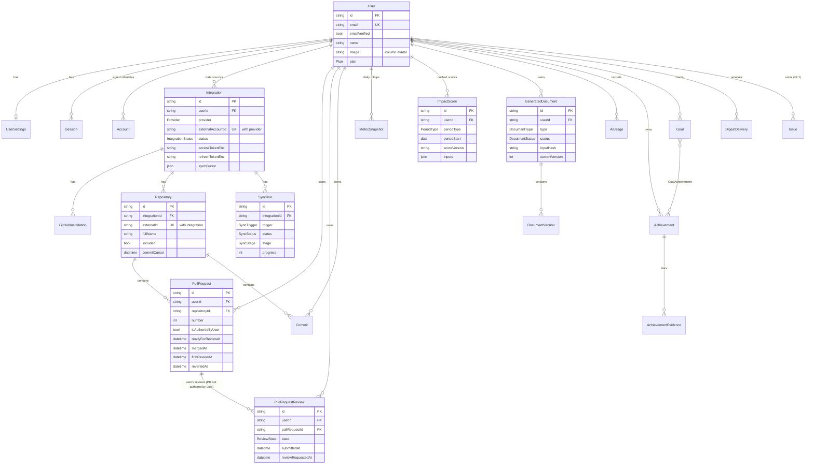

# Data Model v2

*Phase 03 · 2026-11-09 · Status: **binding** (field names may be refined by the implementing
phase if the change is recorded in PROGRESS.md; semantics may not). Fixes DATA-01, DATA-05,
DATA-06, DATA-08, DATA-10 by design.*

Related: [ARCHITECTURE_V2](ARCHITECTURE_V2.md) · [KPI_METHODOLOGY](KPI_METHODOLOGY.md) ·
[API_CONTRACT_V2](API_CONTRACT_V2.md) · current model: [`../audit/ARCHITECTURE_CURRENT.md §3`](../audit/ARCHITECTURE_CURRENT.md#3-data-model)

## Contents
1. [Design rules](#1-design-rules)
2. [ERD](#2-erd)
3. [Prisma schema draft](#3-prisma-schema-draft)
4. [Model notes](#4-model-notes)
5. [Migration plan from v0.1.0](#5-migration-plan-from-v010)
6. [Retention & deletion](#6-retention--deletion)
7. [Phase ownership of schema changes](#7-phase-ownership-of-schema-changes)

---

## 1. Design rules

1. **Every user-owned row has `userId`** with `onDelete: Cascade` from `User` (complete account
   deletion; ARCHITECTURE_V2 §12).
2. **Provider records are keyed by provider identity** (`externalId` = GitHub node ID) *and* a
   natural key (`repositoryId + number`, `userId + sha`) so upserts are idempotent and legacy rows
   can be matched.
3. **Authorship is explicit.** `PullRequest.isAuthoredByUser` distinguishes the user's PRs from
   PRs they reviewed; reviews (`PullRequestReview`) point at a PR row without implying authorship.
4. **Secrets are encrypted columns** with a `*Enc` suffix (ADR-0005); plaintext token columns do
   not exist.
5. **Timestamps are UTC `timestamptz`**; local dates (snapshots, periods, achievements) are
   `date` columns interpreted in the stored timezone.
6. Table names are snake_case plural via `@@map`; columns snake_case via `@map` (omitted below for
   brevity except where a rename preserves a legacy column — P05+ apply `@map` consistently).
7. Prisma migrations only (`prisma migrate`), never `db push` outside throwaway local DBs.

## 2. ERD



## 3. Prisma schema draft

> Better Auth models (`Session`, `Account`, `Verification`, `Jwks`) and the `User` core fields
> must be reconciled with the output of `npx @better-auth/cli generate` for the Better Auth
> version pinned in P05; the semantics below are fixed, exact field names follow the library.

```prisma
generator client {
  provider = "prisma-client-js"
}

datasource db {
  provider = "postgresql"
  url      = env("DATABASE_URL")
}

// ───────────── Enums ─────────────
enum Plan { FREE PRO TEAM ENTERPRISE }                // TEAM/ENTERPRISE reserved (v2.1)
enum Provider { GITHUB GITLAB JIRA LINEAR }           // only GITHUB used in v2.0
enum IntegrationMechanism { GITHUB_APP OAUTH_APP }    // OAUTH_APP = legacy v0.1 rows only
enum IntegrationStatus { ACTIVE NEEDS_REAUTH SUSPENDED DISCONNECTED ERROR }
enum PRState { OPEN CLOSED MERGED }
enum ReviewState { APPROVED CHANGES_REQUESTED COMMENTED DISMISSED }
enum SyncTrigger { INITIAL MANUAL SCHEDULED WEBHOOK RECONNECT }
enum SyncKind { BACKFILL INCREMENTAL TARGETED }
enum SyncStatus { QUEUED RUNNING WAITING_RATE_LIMIT SUCCEEDED PARTIAL FAILED CANCELLED }
enum SyncStage { PREPARE REPOSITORIES AUTHORED_PRS REVIEWED_PRS COMMITS PERSIST ROLLUPS DONE }
enum WebhookStatus { RECEIVED PROCESSED IGNORED FAILED }
enum PeriodType { MONTH QUARTER HALF YEAR CUSTOM }
enum ScoreStatus { OK INSUFFICIENT_DATA }
enum DocumentType { RESUME APPRAISAL PROMOTION IMPACT_NARRATIVE ACHIEVEMENT_STATEMENT DIGEST_SUMMARY }
enum DocumentStatus { PENDING STREAMING READY FAILED CANCELLED }
enum VersionSource { AI USER_EDIT RESTORE }
enum AiFeature { RESUME APPRAISAL PROMOTION IMPACT_NARRATIVE ACHIEVEMENT_STATEMENT DIGEST_SUMMARY }
enum AiCallStatus { SUCCEEDED FAILED CANCELLED }
enum AchievementCategory { DELIVERY QUALITY MENTORING INCIDENT LEADERSHIP LEARNING COLLABORATION OTHER }
enum AchievementSource { MANUAL FROM_ACTIVITY SUGGESTED }
enum EvidenceKind { PULL_REQUEST COMMIT REVIEW }
enum GoalStatus { ACTIVE ACHIEVED MISSED ARCHIVED }
enum GoalComparator { LTE GTE }
enum DigestStatus { SENT SKIPPED FAILED }
// v2.1 (unchanged from v0.1, unused in v2.0)
enum IssueStatus { TODO IN_PROGRESS DONE CANCELLED }
enum IssuePriority { URGENT HIGH MEDIUM LOW NONE }

// ───────────── Identity (Better Auth) ─────────────
model User {
  id            String   @id @default(cuid())
  email         String   @unique
  emailVerified Boolean  @default(false)
  name          String
  image         String?  @map("avatar")             // keeps the v0.1 column
  plan          Plan     @default(FREE)              // Better Auth additionalField (input: false)
  createdAt     DateTime @default(now())
  updatedAt     DateTime @default(now()) @updatedAt

  sessions      Session[]
  accounts      Account[]
  settings      UserSettings?
  integrations  Integration[]
  repositories  Repository[]
  pullRequests  PullRequest[]
  reviews       PullRequestReview[]
  commits       Commit[]
  issues        Issue[]
  syncRuns      SyncRun[]
  snapshots     MetricSnapshot[]
  impactScores  ImpactScore[]
  documents     GeneratedDocument[]
  aiUsage       AiUsage[]
  achievements  Achievement[]
  goals         Goal[]
  digests       DigestDelivery[]

  @@map("users")
}

model Session {
  id        String   @id
  userId    String
  token     String   @unique
  expiresAt DateTime
  ipAddress String?
  userAgent String?
  createdAt DateTime @default(now())
  updatedAt DateTime @updatedAt
  user      User     @relation(fields: [userId], references: [id], onDelete: Cascade)
  @@index([userId])
  @@map("sessions")
}

model Account {                       // sign-in identities only (NOT data sources)
  id                    String    @id
  userId                String
  providerId            String    // "github" | "google" | "credential" (dev only)
  accountId             String    // provider's user id
  accessToken           String?   // encrypted by Better Auth (encryptOAuthTokens: true)
  refreshToken          String?
  idToken               String?
  accessTokenExpiresAt  DateTime?
  refreshTokenExpiresAt DateTime?
  scope                 String?
  password              String?   // dev-login seeded users only
  createdAt             DateTime  @default(now())
  updatedAt             DateTime  @updatedAt
  user                  User      @relation(fields: [userId], references: [id], onDelete: Cascade)
  @@unique([providerId, accountId])
  @@index([userId])
  @@map("accounts")
}

model Verification {
  id         String   @id
  identifier String
  value      String
  expiresAt  DateTime
  createdAt  DateTime @default(now())
  updatedAt  DateTime @updatedAt
  @@index([identifier])
  @@map("verifications")
}

model Jwks {                          // Better Auth JWT plugin signing keys
  id         String   @id
  publicKey  String
  privateKey String                  // encrypted by Better Auth with BETTER_AUTH_SECRET
  createdAt  DateTime @default(now())
  @@map("jwks")
}

model UserSettings {
  userId                String   @id
  timezone              String   @default("UTC")     // IANA; validated with Intl
  currentRole           String?  @db.VarChar(100)
  careerLevel           String?  @db.VarChar(100)
  targetRole            String?  @db.VarChar(100)
  defaultPeriodType     PeriodType @default(MONTH)
  digestEnabled         Boolean  @default(false)     // opt-in
  digestDayOfWeek       Int      @default(1)         // 1 = Monday
  digestHourLocal       Int      @default(9)
  notifySyncFailures    Boolean  @default(true)
  notifyDocumentReady   Boolean  @default(false)
  aiRedactPrivateRepos  Boolean  @default(false)
  onboardingStep        String?                       // resumable wizard
  onboardingCompletedAt DateTime?
  createdAt             DateTime @default(now())
  updatedAt             DateTime @updatedAt
  user                  User     @relation(fields: [userId], references: [id], onDelete: Cascade)
  @@map("user_settings")
}

// ───────────── Integrations & sync ─────────────
model Integration {
  id                    String               @id @default(cuid())
  userId                String
  provider              Provider
  mechanism             IntegrationMechanism @default(GITHUB_APP)
  externalAccountId     String?              // GitHub user node id (null only for legacy rows)
  externalLogin         String?
  displayName           String?
  avatarUrl             String?
  status                IntegrationStatus    @default(ACTIVE)
  statusReason          String?              // e.g. GITHUB_TOKEN_REVOKED
  accessTokenEnc        String?              // "v<keyVersion>.<iv>.<ciphertext>.<tag>" base64url (ADR-0005)
  refreshTokenEnc       String?
  accessTokenExpiresAt  DateTime?
  refreshTokenExpiresAt DateTime?
  permissions           Json                 @default("{}")  // GitHub App permissions snapshot
  syncCursor            Json                 @default("{}")  // { authoredPrsUpdatedAt, reviewedPrsUpdatedAt }
  backfillFrom          DateTime?            // oldest date covered by a completed backfill
  lastSyncedAt          DateTime?            // last run finish (any status)
  lastSuccessfulSyncAt  DateTime?
  scheduleSlotMinute    Int                  @default(0)     // 0..1439 jittered daily slot (UTC)
  disconnectedAt        DateTime?
  createdAt             DateTime             @default(now())
  updatedAt             DateTime             @updatedAt

  user          User                 @relation(fields: [userId], references: [id], onDelete: Cascade)
  installations GitHubInstallation[]
  repositories  Repository[]
  syncRuns      SyncRun[]
  pullRequests  PullRequest[]
  reviews       PullRequestReview[]
  commits       Commit[]
  issues        Issue[]

  @@unique([provider, externalAccountId])   // one GitHub account → one DevImpact user
  @@index([userId, provider])
  @@index([status, scheduleSlotMinute])
  @@map("integrations")
}

model GitHubInstallation {
  id                  String    @id @default(cuid())
  integrationId       String
  installationId      BigInt
  accountLogin        String
  accountType         String    // "User" | "Organization"
  repositorySelection String    // "all" | "selected"
  suspendedAt         DateTime?
  createdAt           DateTime  @default(now())
  updatedAt           DateTime  @updatedAt
  integration         Integration @relation(fields: [integrationId], references: [id], onDelete: Cascade)
  @@unique([integrationId, installationId])
  @@index([installationId])
  @@map("github_installations")
}

model Repository {
  id              String    @id @default(cuid())
  userId          String
  integrationId   String
  externalId      String    // GitHub node id; "legacy:<fullName>" until first v2 sync
  fullName        String    // owner/name
  ownerLogin      String
  name            String
  isPrivate       Boolean   @default(false)
  isFork          Boolean   @default(false)
  isArchived      Boolean   @default(false)
  defaultBranch   String?
  htmlUrl         String?
  installationId  BigInt?   // null = reachable as public repo only
  accessible      Boolean   @default(true)
  included        Boolean   @default(true)
  inclusionSource String    @default("DEFAULT")  // DEFAULT | USER
  commitCursor    DateTime?
  lastActivityAt  DateTime?
  lastSyncedAt    DateTime?
  createdAt       DateTime  @default(now())
  updatedAt       DateTime  @updatedAt

  user         User          @relation(fields: [userId], references: [id], onDelete: Cascade)
  integration  Integration   @relation(fields: [integrationId], references: [id], onDelete: Cascade)
  pullRequests PullRequest[]
  commits      Commit[]

  @@unique([integrationId, externalId])
  @@unique([integrationId, fullName])
  @@index([userId, included])
  @@map("repositories")
}

model PullRequest {
  id                    String    @id @default(cuid())
  userId                String
  integrationId         String
  repositoryId          String
  externalId            String?   // node id (null for legacy rows until refreshed)
  number                Int
  title                 String
  body                  String?   // stored only when isAuthoredByUser (data minimisation)
  url                   String?
  state                 PRState
  isDraft               Boolean   @default(false)
  isAuthoredByUser      Boolean
  authorExternalId      String?
  authorLogin           String?
  labels                String[]  @default([])
  baseRef               String?
  createdAtRemote       DateTime  // GitHub createdAt (v0.1 "timestamp")
  readyForReviewAt      DateTime? // first ReadyForReviewEvent if ever draft
  mergedAt              DateTime?
  closedAt              DateTime?
  updatedAtRemote       DateTime?
  additions             Int?
  deletions             Int?
  changedFiles          Int?
  commitsCount          Int?
  // reviews received (authored PRs only; aggregates, no third-party content)
  firstReviewAt         DateTime?
  reviewersCount        Int?
  approvalsCount        Int?
  changesRequestedCount Int?
  // revert detection
  isRevert              Boolean   @default(false)
  revertedAt            DateTime?
  revertedByUrl         String?
  legacyStub            Boolean   @default(false)  // v0.1 "PR #n" stub awaiting refresh
  syncedAt              DateTime  @default(now())

  user        User                @relation(fields: [userId], references: [id], onDelete: Cascade)
  integration Integration         @relation(fields: [integrationId], references: [id], onDelete: Cascade)
  repository  Repository          @relation(fields: [repositoryId], references: [id], onDelete: Cascade)
  reviews     PullRequestReview[]
  evidence    AchievementEvidence[]

  @@unique([userId, repositoryId, number])       // natural key (matches legacy rows)
  @@unique([userId, externalId])
  @@index([userId, isAuthoredByUser, mergedAt])
  @@index([userId, isAuthoredByUser, createdAtRemote])
  @@index([userId, isAuthoredByUser, closedAt])
  @@index([userId, firstReviewAt])
  @@map("pull_requests")
}

model PullRequestReview {             // reviews submitted BY the user on others' PRs
  id                String      @id @default(cuid())
  userId            String
  integrationId     String
  pullRequestId     String      // PR row with isAuthoredByUser = false
  externalId        String      // review node id; "legacy:<v0.1 id>" for migrated rows
  state             ReviewState
  submittedAt       DateTime
  hasBody           Boolean     @default(false)
  commentsCount     Int         @default(0)   // inline comments in this review
  reviewRequestedAt DateTime?   // earliest request (user or team) ≤ submittedAt
  syncedAt          DateTime    @default(now())

  user        User        @relation(fields: [userId], references: [id], onDelete: Cascade)
  integration Integration @relation(fields: [integrationId], references: [id], onDelete: Cascade)
  pullRequest PullRequest @relation(fields: [pullRequestId], references: [id], onDelete: Cascade)
  evidence    AchievementEvidence[]

  @@unique([userId, externalId])
  @@index([userId, submittedAt])
  @@index([pullRequestId])
  @@map("pull_request_reviews")
}

model Commit {
  id              String   @id @default(cuid())
  userId          String
  integrationId   String
  repositoryId    String
  sha             String
  messageHeadline String
  messageBody     String?
  branch          String   // default branch name the commit was found on
  authoredAt      DateTime // v0.1 "timestamp"
  committedAt     DateTime?
  additions       Int      @default(0)
  deletions       Int      @default(0)
  changedFiles    Int?
  parentsCount    Int      @default(1)
  associatedPrNumber Int?
  authorExternalId String?
  syncedAt        DateTime @default(now())

  user        User        @relation(fields: [userId], references: [id], onDelete: Cascade)
  integration Integration @relation(fields: [integrationId], references: [id], onDelete: Cascade)
  repository  Repository  @relation(fields: [repositoryId], references: [id], onDelete: Cascade)
  evidence    AchievementEvidence[]

  @@unique([userId, sha])      // de-duplicates forks/mirrors
  @@index([userId, authoredAt])
  @@index([repositoryId, authoredAt])
  @@map("commits")
}

model Issue {                         // unchanged from v0.1; populated in v2.1 (Jira/Linear)
  id            String        @id @default(cuid())
  userId        String
  integrationId String
  title         String
  labels        String[]
  storyPoints   Int?
  priority      IssuePriority @default(NONE)
  status        IssueStatus   @default(TODO)
  projectName   String?
  timestamp     DateTime
  user          User        @relation(fields: [userId], references: [id], onDelete: Cascade)
  integration   Integration @relation(fields: [integrationId], references: [id], onDelete: Cascade)
  @@index([userId, timestamp])
  @@map("issues")
}

model SyncRun {
  id                 String      @id @default(cuid())
  userId             String
  integrationId      String
  trigger            SyncTrigger
  kind               SyncKind
  status             SyncStatus  @default(QUEUED)
  stage              SyncStage   @default(PREPARE)
  progress           Int         @default(0)       // 0..100
  windowFrom         DateTime?
  windowTo           DateTime?
  counts             Json        @default("{}")    // { repos, prsAuthored, prsReviewed, reviews, commits, created, updated }
  apiCalls           Int         @default(0)
  rateLimitRemaining Int?
  resumeAt           DateTime?
  errorCode          String?
  errorMessage       String?     // safe, user-facing
  errors             Json        @default("[]")    // [{ stage, repo?, code, message, at }]
  jobId              String?
  webhookDeliveryId  String?
  queuedAt           DateTime    @default(now())
  startedAt          DateTime?
  finishedAt         DateTime?

  user        User        @relation(fields: [userId], references: [id], onDelete: Cascade)
  integration Integration @relation(fields: [integrationId], references: [id], onDelete: Cascade)

  @@index([integrationId, queuedAt(sort: Desc)])
  @@index([userId, queuedAt(sort: Desc)])
  @@index([status])
  @@map("sync_runs")
}

model WebhookDelivery {               // global (not user-owned): idempotency + audit
  id             String        @id   // X-GitHub-Delivery GUID
  provider       Provider
  event          String
  action         String?
  installationId BigInt?
  status         WebhookStatus @default(RECEIVED)
  error          String?
  receivedAt     DateTime      @default(now())
  processedAt    DateTime?
  @@index([receivedAt])
  @@map("webhook_deliveries")
}

// ───────────── Metrics ─────────────
model MetricSnapshot {
  id                String   @id @default(cuid())
  userId            String
  date              DateTime @db.Date      // local date in `timezone`
  timezone          String
  commits           Int      @default(0)
  prsOpened         Int      @default(0)
  prsMerged         Int      @default(0)
  prsClosedUnmerged Int      @default(0)
  reviewsSubmitted  Int      @default(0)
  prsReviewed       Int      @default(0)   // distinct PRs reviewed that day
  reviewComments    Int      @default(0)
  achievements      Int      @default(0)
  active            Boolean  @default(false)
  metricsVersion    String
  computedAt        DateTime @default(now())
  user              User     @relation(fields: [userId], references: [id], onDelete: Cascade)
  @@unique([userId, date])
  @@index([userId, date])
  @@map("metric_snapshots")
}

model ImpactScore {
  id             String      @id @default(cuid())
  userId         String
  periodType     PeriodType
  periodStart    DateTime    @db.Date
  periodEnd      DateTime    @db.Date
  timezone       String
  scoreVersion   String      // "impact@2.0.0"
  metricsVersion String      // "metrics@2.0.0"
  status         ScoreStatus
  overall        Float?
  delivery       Float?
  quality        Float?
  collaboration  Float?
  ownership      Float?
  inputs         Json        // KPI_METHODOLOGY §6.6 — also serves /metrics/kpis
  explanation    String
  computedAt     DateTime    @default(now())
  user           User        @relation(fields: [userId], references: [id], onDelete: Cascade)
  @@unique([userId, periodType, periodStart, periodEnd, scoreVersion])
  @@index([userId, periodType, periodStart])
  @@map("impact_scores")
}

// ───────────── AI documents ─────────────
model GeneratedDocument {
  id               String         @id @default(cuid())
  userId           String
  type             DocumentType
  title            String         @db.VarChar(200)
  status           DocumentStatus @default(PENDING)
  currentVersion   Int            @default(0)     // 0 until first version saved
  options          Json           // validated per type (role, format, period, roles, notes…)
  periodStart      DateTime?      @db.Date
  periodEnd        DateTime?      @db.Date
  timezone         String?
  promptId         String
  promptVersion    Int
  model            String
  inputHash        String         // sha256 (ADR-0009)
  evidenceRefs     String[]       @default([])
  citationCoverage Float?
  errorCode        String?
  sourceImpactScoreId String?     // IMPACT_NARRATIVE
  createdAt        DateTime       @default(now())
  updatedAt        DateTime       @updatedAt

  user     User              @relation(fields: [userId], references: [id], onDelete: Cascade)
  versions DocumentVersion[]
  aiUsage  AiUsage[]

  @@index([userId, type, createdAt(sort: Desc)])
  @@index([userId, inputHash])
  @@map("generated_documents")
}

model DocumentVersion {
  id         String        @id @default(cuid())
  documentId String
  version    Int
  content    Json          // Zod-validated per DocumentType (shared schemas)
  source     VersionSource
  createdAt  DateTime      @default(now())
  document   GeneratedDocument @relation(fields: [documentId], references: [id], onDelete: Cascade)
  @@unique([documentId, version])
  @@map("document_versions")
}

model AiUsage {
  id               String       @id @default(cuid())
  userId           String
  documentId       String?
  feature          AiFeature
  promptId         String
  promptVersion    Int
  model            String
  inputTokens      Int          @default(0)
  outputTokens     Int          @default(0)
  cacheReadTokens  Int          @default(0)
  cacheWriteTokens Int          @default(0)
  costMicroUsd     BigInt       @default(0)
  latencyMs        Int
  status           AiCallStatus
  countsTowardQuota Boolean     @default(true)  // false for failures/cancellations
  errorCode        String?
  createdAt        DateTime     @default(now())
  user             User               @relation(fields: [userId], references: [id], onDelete: Cascade)
  document         GeneratedDocument? @relation(fields: [documentId], references: [id], onDelete: SetNull)
  @@index([userId, createdAt])
  @@index([userId, feature, createdAt])
  @@map("ai_usage")
}

// ───────────── Career OS ─────────────
model Achievement {
  id          String              @id @default(cuid())
  userId      String
  title       String              @db.VarChar(200)
  description String?             // markdown ≤ 5000 chars
  impact      String?             // ≤ 1000 chars
  category    AchievementCategory
  occurredOn  DateTime            @db.Date
  links       Json                @default("[]")   // [{ url, label }] ≤ 10
  source      AchievementSource   @default(MANUAL)
  createdAt   DateTime            @default(now())
  updatedAt   DateTime            @updatedAt
  user        User                  @relation(fields: [userId], references: [id], onDelete: Cascade)
  evidence    AchievementEvidence[]
  goals       GoalAchievement[]
  @@index([userId, occurredOn])
  @@map("achievements")
}

model AchievementEvidence {
  id            String       @id @default(cuid())
  achievementId String
  kind          EvidenceKind
  pullRequestId String?
  commitId      String?
  reviewId      String?
  achievement   Achievement        @relation(fields: [achievementId], references: [id], onDelete: Cascade)
  pullRequest   PullRequest?       @relation(fields: [pullRequestId], references: [id], onDelete: Cascade)
  commit        Commit?            @relation(fields: [commitId], references: [id], onDelete: Cascade)
  review        PullRequestReview? @relation(fields: [reviewId], references: [id], onDelete: Cascade)
  // CHECK (exactly one of pullRequestId, commitId, reviewId is non-null) — raw SQL in migration
  @@index([achievementId])
  @@map("achievement_evidence")
}

model Goal {
  id          String          @id @default(cuid())
  userId      String
  title       String          @db.VarChar(200)
  description String?
  status      GoalStatus      @default(ACTIVE)
  startDate   DateTime        @db.Date
  targetDate  DateTime?       @db.Date
  metricKey   String?         // KPI_METHODOLOGY key, e.g. review_turnaround_median_hours
  comparator  GoalComparator?
  targetValue Float?
  createdAt   DateTime        @default(now())
  updatedAt   DateTime        @updatedAt
  user         User              @relation(fields: [userId], references: [id], onDelete: Cascade)
  achievements GoalAchievement[]
  @@index([userId, status])
  @@map("goals")
}

model GoalAchievement {
  goalId        String
  achievementId String
  goal          Goal        @relation(fields: [goalId], references: [id], onDelete: Cascade)
  achievement   Achievement @relation(fields: [achievementId], references: [id], onDelete: Cascade)
  @@id([goalId, achievementId])
  @@map("goal_achievements")
}

model DigestDelivery {
  id        String       @id @default(cuid())
  userId    String
  weekStart DateTime     @db.Date   // local Monday
  status    DigestStatus
  error     String?
  sentAt    DateTime     @default(now())
  user      User         @relation(fields: [userId], references: [id], onDelete: Cascade)
  @@unique([userId, weekStart])
  @@map("digest_deliveries")
}
```

## 4. Model notes

### User / Better Auth
- `image` maps to the existing `avatar` column, so no data copy is needed.
- `plan` is a Better Auth `additionalFields` entry with `input: false` (users cannot set it).

### Integration
- `mechanism = OAUTH_APP` exists only so migrated v0.1 rows are representable; they start as
  `NEEDS_REAUTH` with tokens removed (§5, step P05-3).
- `scheduleSlotMinute` = `hash(integrationId) mod 1440`, so daily syncs spread over the day.
- Status transitions: `ACTIVE → NEEDS_REAUTH` (401 / refresh failure / app authorization revoked),
  `ACTIVE → SUSPENDED` (installation suspended), `* → DISCONNECTED` (user action),
  `ACTIVE → ERROR` (repeated non-auth failures; cleared by the next successful run).

### PullRequest
- One row per (user, PR). If Alice authors and Bob reviews the same PR and both use DevImpact,
  Alice has a row with `isAuthoredByUser = true` and Bob one with `false`.
- `firstReviewAt`, `reviewersCount`, `approvalsCount`, `changesRequestedCount` are populated for
  authored PRs only (from reviews by others; bots excluded).
- `readyForReviewAt`: first `ReadyForReviewEvent`; null when the PR was never a draft
  (`readyAt = createdAtRemote` in KPI formulas).
- `legacyStub = true` marks v0.1 rows whose title matched `^PR #\d+$` with `state = CLOSED`, no
  body, and a review by the same user; they are excluded from all metrics until refreshed.

### MetricSnapshot / ImpactScore
- Snapshots store additive counters only (KPI_METHODOLOGY §4). `ImpactScore.inputs` doubles as the
  period-metrics cache for `/metrics/kpis` (one computation serves both endpoints).

### GeneratedDocument / DocumentVersion
- Content schemas per type live in `packages/shared/src/schemas/documents/*.ts` (P08) — e.g.
  `ResumeContent { bullets: [{ id, text, theme, citations: Ref[], flags? }] , summary? }`,
  `AppraisalContent { sections: { executiveSummary, keyContributions[], metrics (engine-filled), areasOfImpact, growth, nextGoals } }`,
  `PromotionContent { sections: { whyReady, leadershipEvidence, technicalImpact, businessValue, mentorship, supportingData (engine-filled) } }`.
- Every user edit creates a new `DocumentVersion` (autosave debounced to at most one version per
  30 s per document in the API; the latest unsaved draft lives client-side). Keep the last 50.

## 5. Migration plan from v0.1.0

**Baseline.** P02 creates `0000_baseline` from the v0.1.0 schema exactly as deployed (via
`prisma migrate diff --from-empty --to-schema-datamodel`) and marks it applied on existing
databases (`prisma migrate resolve --applied 0000_baseline`). Every later change is a forward
migration owned by the phase below. Data steps that need application code (encryption) are
TypeScript scripts in `apps/api/prisma/scripts/` run by the migration runbook, idempotent.

| Step | Phase | Migration | Schema change | Data step | Drops |
|---|---|---|---|---|---|
| P05-1 | P05 | `auth_better_auth` | Create `sessions`, `accounts`, `verifications`, `jwks`; `users` add `email_verified` (default false), `updated_at` | Legacy users get no `Account`; they are linked on first social sign-in by verified email (Better Auth account linking) | — |
| P05-2 | P05 | `user_settings` | Create `user_settings` | Insert a default row (`timezone='UTC'`) for every existing user | — |
| P05-3 | P05 | `integration_v2_security` | `integrations` add `mechanism`, `external_account_id`, `external_login`, `display_name`, `avatar_url`, `status`, `status_reason`, `access_token_enc`, `refresh_token_enc`, expiries, `permissions`, `sync_cursor`, `backfill_from`, `last_synced_at`, `last_successful_sync_at`, `schedule_slot_minute`, `disconnected_at`; create `github_installations`; drop unique `(user_id, provider)`; add unique `(provider, external_account_id)` | Backfill `external_login`, `display_name`, `avatar_url` from `metadata` JSON; set `mechanism='OAUTH_APP'`, `status='NEEDS_REAUTH'`, `status_reason='MIGRATED_FROM_V0'` (OAuth App tokens cannot drive the GitHub App, ADR-0004) | `access_token`, `refresh_token`, `metadata` (after backfill) — **no plaintext tokens remain** |
| P06-1 | P06 | `repositories` | Create `repositories` | Insert one row per distinct `(integration_id, repo)` from `commits.repo` ∪ `pull_requests.repo` with `external_id = 'legacy:'||fullName`, `included = true` | — |
| P06-2 | P06 | `activity_v2` | `commits`: add `repository_id`, `message_headline`, `message_body`, `authored_at`, `committed_at`, `changed_files`, `parents_count`, `associated_pr_number`, `author_external_id`, `synced_at`. `pull_requests`: add the v2 columns, `repository_id`, `is_authored_by_user`, `legacy_stub`; rename `timestamp → created_at_remote`. Create `pull_request_reviews`, `sync_runs`, `webhook_deliveries` | Commits: `message_headline = message`, `authored_at = timestamp`, `repository_id` via fullName. PRs: `repository_id` via fullName; `legacy_stub = (title ~ '^PR #[0-9]+$' AND state='CLOSED' AND body IS NULL AND EXISTS review by same user)`; `is_authored_by_user = NOT legacy_stub`. `code_reviews` → `pull_request_reviews` (`state = approved ? 'APPROVED' : 'COMMENTED'`, `has_body = comments > 0`, `comments_count = 0`, `external_id = 'legacy:'||id`) | `commits.message`, `commits.timestamp`, `commits.repo`, `pull_requests.repo`, `pull_requests.review_count`, table `code_reviews` |
| P06-3 | P06 | *(code, not schema)* | — | On the **first successful v2 backfill** of an integration: legacy repos are matched by `fullName` and get real `external_id`s; PR upserts hit the natural key `(user_id, repository_id, number)` and overwrite legacy rows (clearing `legacy_stub`, recomputing `is_authored_by_user`); then delete remaining `legacy_stub` PRs and `legacy:` reviews for that integration (they are fully re-derived from GitHub) | legacy rows |
| P07-1 | P07 | `metrics_v2` | Create `metric_snapshots`; rename v0.1 `impact_scores` → `impact_scores_legacy`; create new `impact_scores` | None — v0.1 scores were LLM-generated (AI-01) and are not migrated or displayed | `impact_scores_legacy` dropped in P15 |
| P08-1 | P08 | `documents_v2` | `generated_documents` add `title`, `status`, `current_version`, `options`, `period_*`, `timezone`, `prompt_*`, `model`, `input_hash`, `evidence_refs`, `citation_coverage`, `error_code`, `source_impact_score_id`, `updated_at`; create `document_versions`, `ai_usage`; `DocumentType` enum: add new values, remove `KPI` (no rows ever) | Each v0.1 document → `DocumentVersion` v1 `{ legacy: true, raw: <content> }`, `status = READY`, `title = '<Type> (imported)'`, `options = { dateRange }`, `prompt_id = 'legacy'`, `prompt_version = 0`, `model = 'unknown'`, `input_hash = 'legacy:'||id` | `content`, `date_range` columns (after copy) |
| P12-1 | P12 | `career_os` | Create `achievements`, `achievement_evidence` (+ CHECK constraint), `goals`, `goal_achievements`, `digest_deliveries`; add settings columns if not created in P05 | — | — |
| P15-1 | P15 | `drop_legacy` | Drop `impact_scores_legacy`; drop enum value `OAUTH_APP` if no rows remain | — | legacy |

**Rollback strategy.** Each migration is forward-only in production; before P05-3, P06-2 and
P08-1 the runbook takes a `pg_dump` (P14 documents restore). Down-migrations are written for local
development only.

**Fixture coverage.** P02's seed and the P01 fixture (`docs/v2/audit/scripts/seed-fixture.ts`)
include stub PRs; P06 adds a migration test that runs P06-1/P06-2 on that fixture and asserts:
Alice's authored PR count drops from 106 to 41 (the 65 stubs become `legacy_stub`), no commits are
lost, and reviews are preserved.

## 6. Retention & deletion

| Data | Retention | Mechanism |
|---|---|---|
| Account & all user-owned rows | Until the user deletes the account → **hard delete immediately** (cascade) | `DELETE /me`; integration tokens revoked at GitHub first (best effort) |
| Activity (PRs, reviews, commits) | While the integration exists; on disconnect user chooses keep or purge; excluded repos' data kept until purge | `DELETE /integrations/:id?purgeData=true`, `POST /repos/:id/purge` (S) |
| `SyncRun` | 90 days, and at most the last 200 per integration | `maintenance.retention` daily |
| `WebhookDelivery` | 14 days | daily |
| `Session` / `Verification` | until expiry + 7 days | daily |
| `MetricSnapshot` | recomputable; kept for the plan history window | rebuilt on demand |
| `ImpactScore` | current version: history window; older versions: 13 months | daily |
| `DocumentVersion` | last 50 per document | on write |
| `AiUsage` | 13 months raw (quota + cost audit) | daily |
| `DigestDelivery` | 12 months | daily |
| Logs | 30 days (hosting-dependent), no tokens or document content in logs | platform |
| Backups | 7 daily + 4 weekly (P14/P15); deleted users disappear from backups within 35 days | platform |

Data export (`GET /me/export`) returns every user-owned table except encrypted tokens and
Better Auth secrets (ADR-0014 / API_CONTRACT_V2 §5).

## 7. Phase ownership of schema changes

| Phase | Owns |
|---|---|
| P02 | Baseline migration, migrate workflow, seed updates for the baseline |
| P05 | P05-1..3 (auth, settings, integration security, installations) |
| P06 | P06-1..3 (repositories, activity v2, reviews, sync runs, webhooks, legacy purge) |
| P07 | P07-1 (snapshots, impact scores v2) |
| P08 | P08-1 (documents v2, versions, AI usage) |
| P12 | P12-1 (achievements, goals, digests) |
| P15 | P15-1 (drop legacy) |
