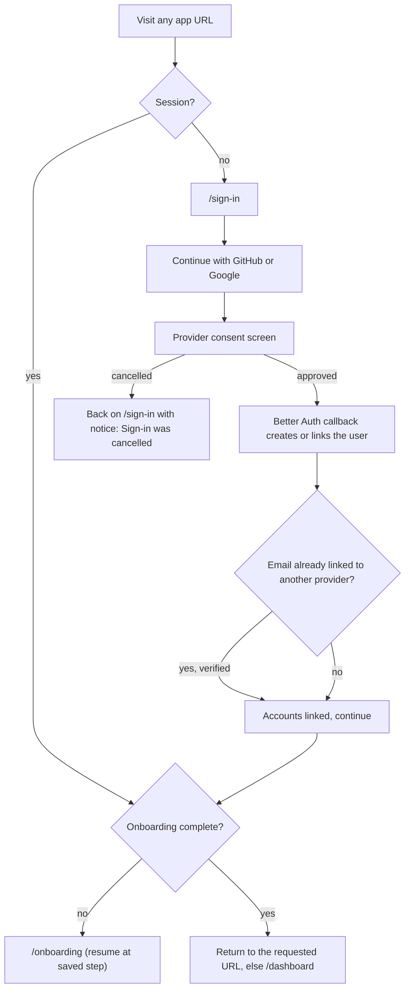
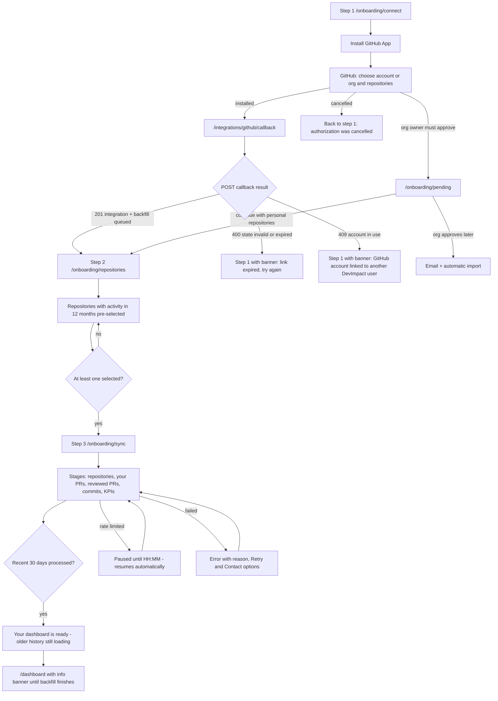
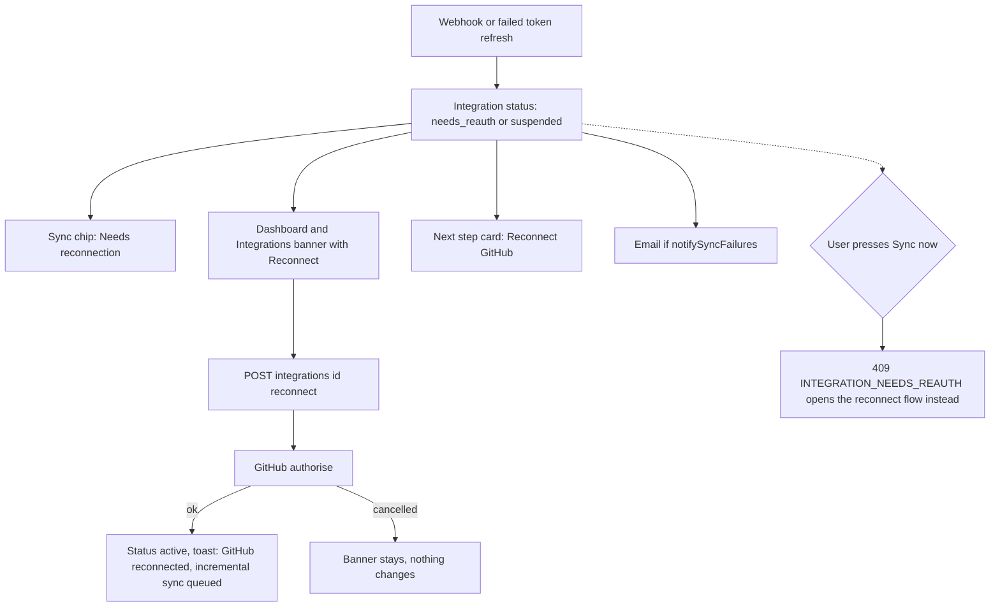
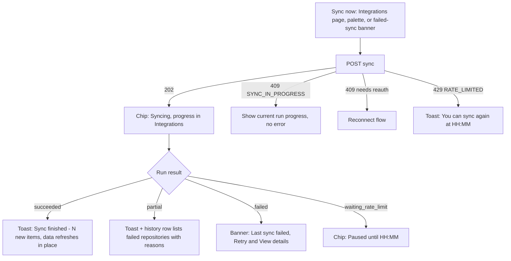
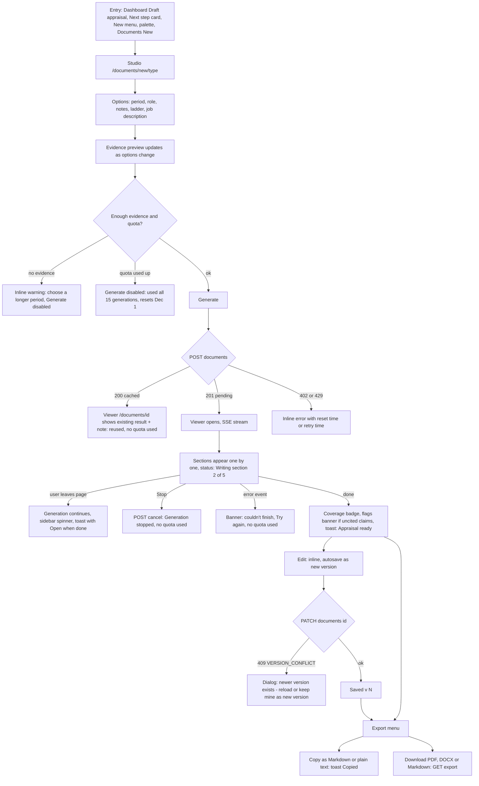
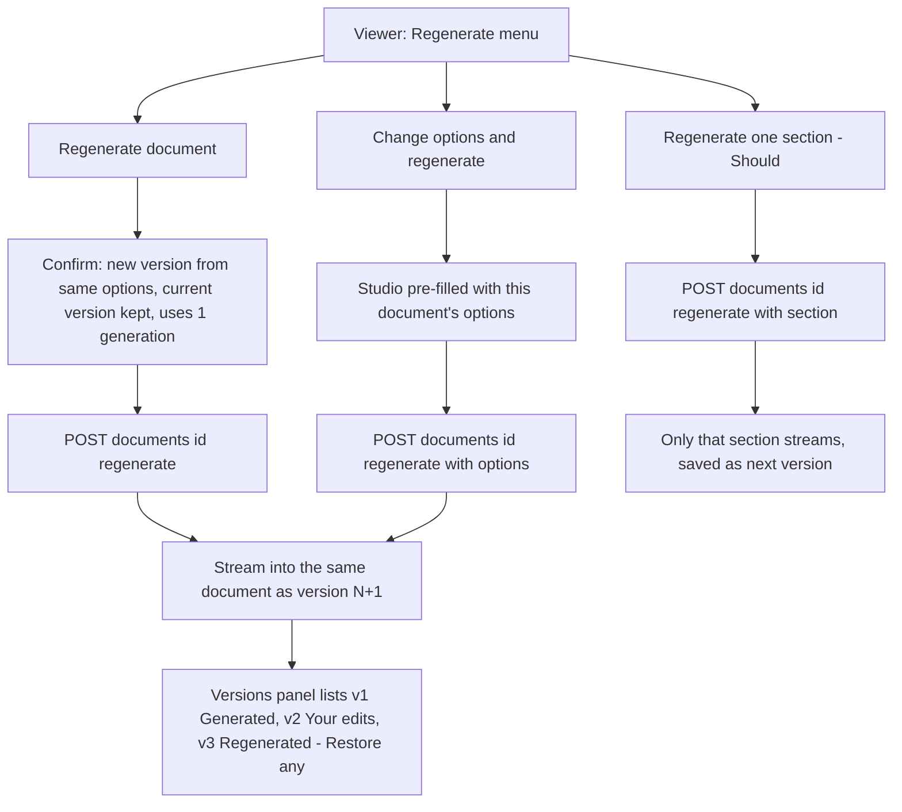
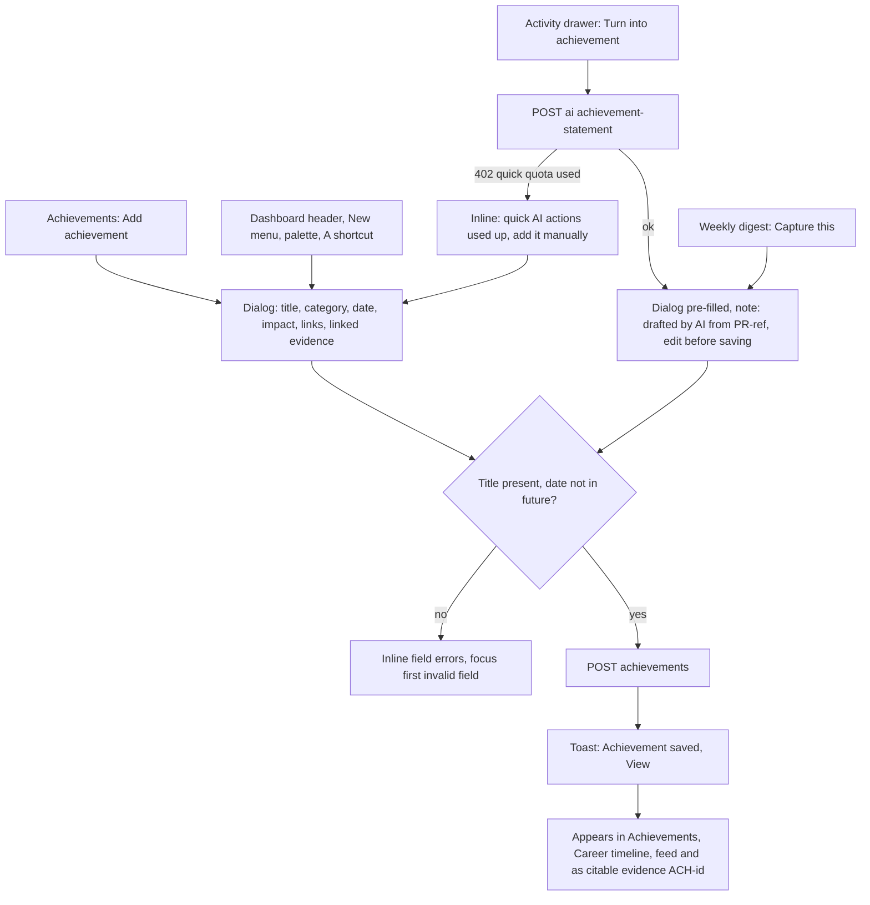
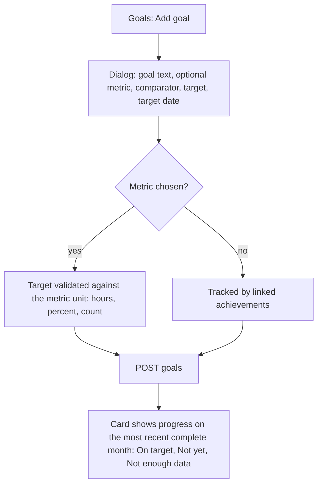
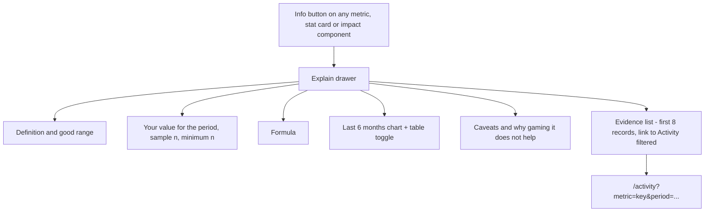
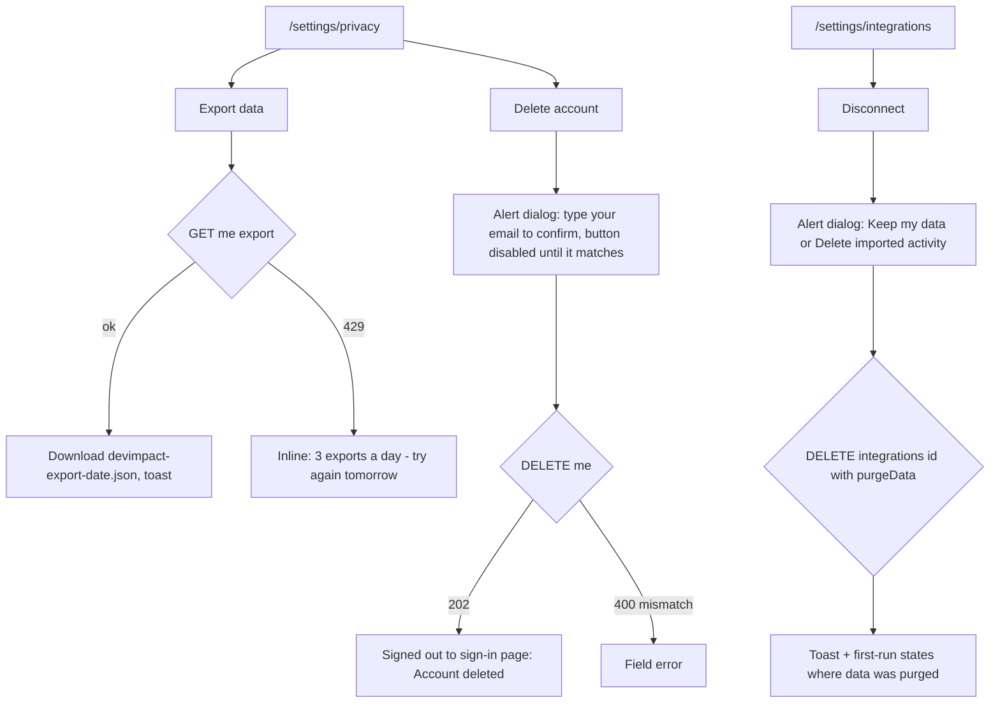

# User Flows — DevImpact AI v2.0

*Phase 04 · 2026-11-09.* Each flow lists the trigger, the steps (Mermaid flowchart), every
non-happy branch, the API calls involved ([API_CONTRACT_V2](../blueprint/API_CONTRACT_V2.md)) and the
copy for the key moments. Routes follow [IA.md](IA.md). Flows map to the PRD journeys
(UJ-1…UJ-8) that P14 turns into E2E tests.

| # | Flow | PRD journey |
|---|---|---|
| F1 | Sign-up / sign-in | UJ-1 |
| F2 | Onboarding wizard (connect → repositories → first sync → dashboard) | UJ-1 |
| F3 | Reconnect / expired or revoked access | UJ-8 |
| F4 | Manual sync | — (F-13) |
| F5 | Generate → stream → edit → export a document | UJ-2, UJ-3, UJ-4 |
| F6 | Regenerate (same options, different options, one section) | UJ-2–4 |
| F7 | Add an achievement (manual, from a PR, from the digest) | UJ-5 |
| F8 | Set a goal | — (F-62) |
| F9 | Explain a metric | UJ-6 |
| F10 | Export my data / delete my account / disconnect | UJ-7 |

---

## F1 · Sign-up / sign-in

- **APIs:** web `POST /api/auth/sign-in/social`, `GET /api/auth/callback/:provider`, then `GET /me`
  (`onboarding.step`, `onboarding.completed`). Dev: `POST /api/dev-login` (button only when
  `ENABLE_DEV_LOGIN=true` outside production).
- **States:** provider error → inline banner "We couldn't sign you in with GitHub. Try again, or use
  Google." Session expired while using the app → token refresh silently; if refresh fails, redirect
  to `/sign-in?returnTo=` with "Your session ended. Sign in to continue."
- **Copy:** "Signing in only reads your name and email. Connecting repository data is a separate,
  read-only step you control."

## F2 · Onboarding wizard

- **APIs:** `POST /integrations/github/connect { returnTo: '/onboarding' }` → `{ url, mode }`;
  `POST /integrations/github/callback { code, state, installationId, setupAction }`;
  `GET /repos?integrationId=` + `PATCH /repos { ids, included }`; progress via
  `GET /sync/stream?runId=` (SSE, Should) with polling fallback `GET /sync/status` every 2 s
  (30 s while `waiting_rate_limit`); `PATCH /me/settings { onboardingStep, timezone }` after each step.
- **Resumable:** leaving at any step stores `onboardingStep`; `/onboarding` redirects back there.
  "Finish later" goes to the dashboard first-run state (checklist).
- **Time zone:** prefilled from the browser on step 1 (`Intl.DateTimeFormat().resolvedOptions().timeZone`)
  and shown as "Times will be shown in Europe/London" with a link to change it.
- **Recent-first:** the "dashboard ready" moment is the first `SyncRunDto` where
  `recentWindowCompletedAt` is set (API amendment A-4); the banner stays on Overview pages until the
  run is `succeeded`.
- **Copy:** org pending — "Waiting for harbor-io to approve DevImpact. An organization owner must
  approve it on GitHub before DevImpact can read those repositories." with a copyable message for the admin.

## F3 · Reconnect (expired or revoked access, app uninstalled, installation suspended)

- Data is never deleted by this flow. Copy: "GitHub revoked DevImpact's access on Nov 8. Your data is
  kept, but nothing new is imported until you reconnect."
- `suspended` (org suspended the installation): banner names the org and says "Ask an owner of
  harbor-io to unsuspend DevImpact. Your personal repositories keep syncing."

## F4 · Manual sync

- Button is disabled with a reason while a run is queued/running ("A sync is already running").
- Data on screen refreshes by invalidating TanStack Query keys for metrics, activity and career on
  `done` — no page reload.

## F5 · Generate → stream → edit → export

- **APIs:** `POST /documents/preview-evidence`, `POST /documents`, `GET /documents/:id/stream`
  (fetch-based SSE, `Last-Event-ID` resume), `POST /documents/:id/cancel`, `GET /documents/:id`,
  `PATCH /documents/:id { baseVersion, content }`, `GET /documents/:id/export?format=`.
- **Peak moment:** the first section appears < 8 s after Generate (NFR); the status line names the
  section being written so the wait is legible (Doherty threshold). Screen readers hear one polite
  announcement per completed section, not per token.
- **Citations:** every claim ends with evidence chips; clicking a chip opens a popover (title, repo,
  date, GitHub link). Uncited / invalid claims get a wavy warning underline plus a "No evidence linked"
  chip, and a banner summarises them before export.
- **Ending:** "Appraisal ready — 96% of claims cited." with Export as the primary action.

## F6 · Regenerate

- Regenerating never discards edits: the previous version remains in history; Restore creates a new
  version (`source: restore`). 409 `GENERATION_IN_PROGRESS` → "This document is still being written."

## F7 · Add an achievement

- Delete is immediate with an **Undo** toast (7 s) instead of a confirmation dialog.

## F8 · Set a goal

- Goal status uses semantic badges with icon + text; the comparison month is stated on the page
  ("Progress is measured on October 2026, your most recent complete month").

## F9 · Explain a metric

- **APIs:** `GET /metrics/definitions` (cached 1 h), the page's `MetricValue`, `GET /metrics/timeseries`,
  `GET /metrics/evidence` (API amendment A-2).

## F10 · Export data, delete account, disconnect

- Destructive actions use `alertdialog`, name the consequence in the title ("Delete your account?"),
  list what is deleted, and put the destructive button last with explicit copy ("Delete account",
  never "OK").
